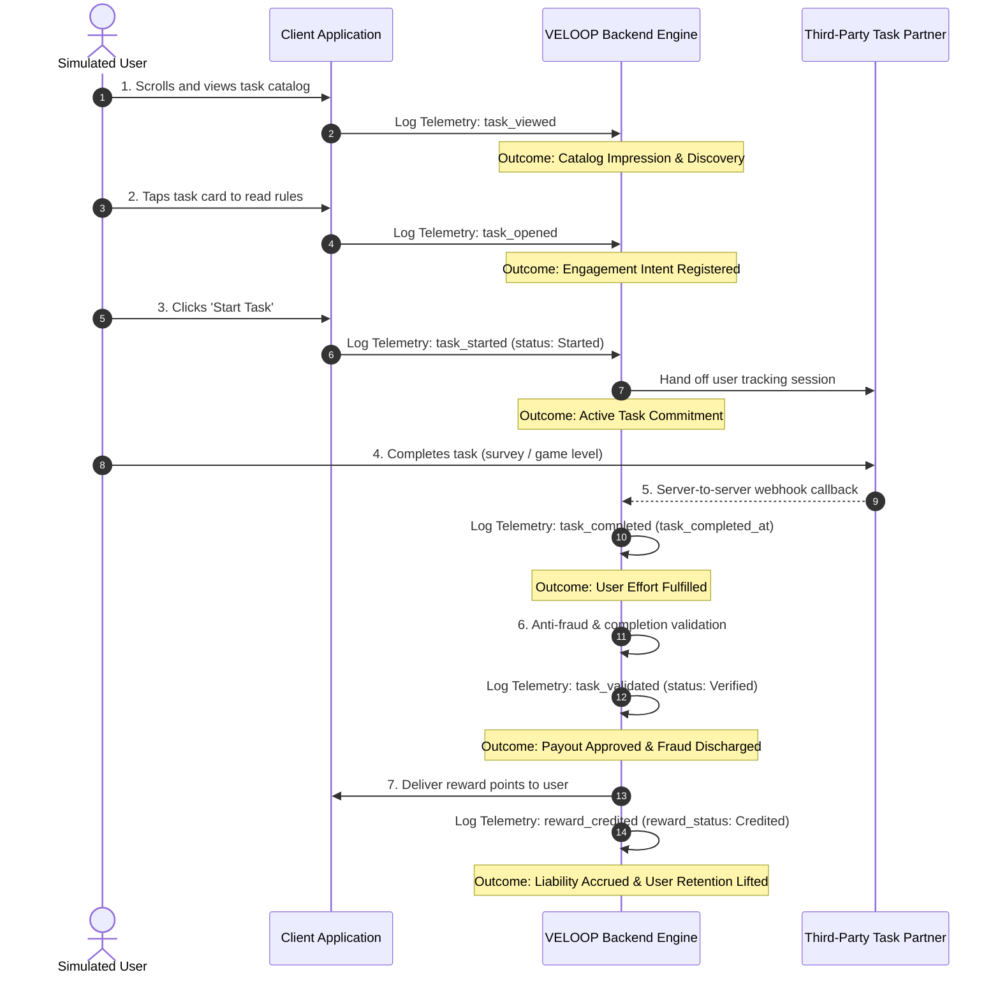

# VELOOP Rewards — Product Data Audit & Telemetry Coverage

> **CRITICAL GOVERNANCE NOTICE**: All product features, telemetry evaluations, event taxonomies, and coverage statuses documented in this audit reflect **SIMULATED DATA** created for analytical testing and product architecture modeling. No real production telemetry or user PII was evaluated.

---

## 1. Product Areas Audit

### 1.1 Registration
- **User Action**: The prospective user installs or opens the application, selects an authentication provider (Google Sign-In, Email/Auth-Credential, or Phone OTP), enters required profile fields (name, age, gender, state, city), and submits the registration form.
- **System Action**: The backend authentication service creates a new user profile record, assigns an immutable `user_id` (`VLUSR000001`–`VLUSR001000`), logs the `acquisition_source` and UTM referral attributes, hashes security credentials, and generates a verification challenge.
- **Key Outcomes**: Acquisition channel velocity, top-of-funnel signup volume, demographic distribution (age, state, city), and user acquisition cost (CAC) attribution.

### 1.2 Login
- **User Action**: The returning user launches the application, presents biometrics or session credentials, and navigates into the main product viewport.
- **System Action**: The session management service authenticates the user, generates a unique `session_id` (`SESS0000001`–`SESS0007913`), logs client device and OS characteristics, updates `last_login_datetime`, and initializes session timeout counters.
- **Key Outcomes**: Daily and Monthly Active Users (DAU/MAU), session frequency per user, session duration distribution, and device landscape allocation (Android vs. iOS vs. Web).

### 1.3 Onboarding
- **User Action**: The newly registered user progresses through an introductory tutorial explaining earning mechanisms, reward point mechanics, and profile personalization preferences.
- **System Action**: The client app logs milestone step completions, records consent preferences (`consent_status`, `marketing_opt_in`), updates `onboarding_status` (`Completed`, `Started`, `Not Started`), and issues an initial activation XP bonus.
- **Key Outcomes**: Onboarding funnel drop-off rate, time-to-first-earning action, activation rate, and day-0 user drop-off mitigation.

### 1.4 Watch Ads / Offers
- **User Action**: The user selects rewarded video ads or sponsored offerwall cards on the dashboard and watches 15–30 second partner video promotions to full completion.
- **System Action**: The app requests ad unit inventory from third-party mediation SDKs, verifies complete ad playback, triggers an ad network postback validation webhook, and credits reward points to the user.
- **Key Outcomes**: Ad viewability, video completion rate, publisher eCPM revenue yield, and reward point unit economics per impression.

### 1.5 Daily Rewards
- **User Action**: The user visits the daily rewards screen each calendar day and taps the active check-in calendar card to claim their daily bonus.
- **System Action**: The server evaluates the 24-hour eligibility window, verifies unbroken daily continuity, increments `streak_activity`, awards escalating XP prizes, and schedules tomorrow's local push notification reminder.
- **Key Outcomes**: Consecutive day habituation, 7-day streak retention, daily retention cohorts, and push notification return-rate efficacy.

### 1.6 Tap & Earn
- **User Action**: The user repeatedly taps an energetic coin or core graphic on the screen during spare micro-moments to accumulate incremental earning units.
- **System Action**: The client-side gaming engine validates tap velocity against anti-macro bot thresholds, decrements an energy meter, buffers points locally, and syncs aggregated scores to the backend upon session close.
- **Key Outcomes**: Average session length extension, bot/autoclicker fraud rejection rate, engagement depth per active day, and point generation velocity.

### 1.7 Mining
- **User Action**: The user navigates to the passive earning hub, clicks 'Start Mining', and activates an automated cloud-mining cycle that generates points over an 8-hour duration.
- **System Action**: The backend initializes a mining timer, calculates passive yield accumulation based on the user's level multiplier, terminates accumulation upon cycle completion, and triggers a 'Yield Ready' notification.
- **Key Outcomes**: Re-engagement cycle interval, notification claim latency, passive-to-active session conversion, and platform stickiness.

### 1.8 Spin the Wheel
- **User Action**: The user enters the gamified lucky wheel viewport, spends an earned spin ticket or claims their free daily spin, and taps the 'Spin' control.
- **System Action**: The game engine verifies ticket balance, queries a server-side pseudo-random number generator (PRNG) with weighted prize tables, executes the spin visual reel, and credits the won prize.
- **Key Outcomes**: Gamification engagement rate, prize payout distribution vs. theoretical Return-to-Player (RTP), ticket sink velocity, and variable reward dopamine response.

### 1.9 Tasks
- **User Action**: The user browses partner micro-tasks (app testing, surveys, partner game levels), reviews task requirements and reward bounties, and clicks 'Start Task' to navigate to third-party partner surfaces.
- **System Action**: The task engine creates an `activity_id` in `05_Task_Activity`, sets `task_status` to `Started`, monitors completion via advertiser postback webhooks, records `failure_reason` if abandoned, and sets `reward_status` to `Credited` upon verified completion.
- **Key Outcomes**: Task conversion rate, task failure rate, partner advertiser ROI, revenue margin per task category (Games vs. Surveys vs. Installs), and user task churn.

### 1.10 Missions
- **User Action**: The user opens the Missions dashboard to review daily and weekly quest goals (e.g., 'Complete 2 surveys and watch 3 ads').
- **System Action**: The mission service aggregates user event telemetry across features, calculates goal completion percentages, unlocks completed quest tiers, and credits bonus milestone points.
- **Key Outcomes**: Multi-feature engagement cross-pollination, daily mission completion velocity, retention elasticity, and goal-gradient user motivation.

### 1.11 Badges
- **User Action**: The user browses their achievement profile showcase to view earned achievement trophies and review unlock criteria for locked badges.
- **System Action**: The milestone engine evaluates historical event aggregates, identifies achieved threshold criteria, awards permanent badge metadata to the user profile, and triggers a celebratory micro-animation.
- **Key Outcomes**: Long-term intrinsic motivation, status recognition, collection completion rates, and power-user differentiation.

### 1.12 Levels (Level System)
- **User Action**: The user tracks their progressive level bar and tier status (Bronze, Silver, Gold, Platinum) by accumulating cumulative lifetime XP.
- **System Action**: The progression engine checks accumulated points, triggers tier upgrades upon reaching XP milestones, unlocks higher earning multipliers, and adjusts payout maximums.
- **Key Outcomes**: User lifetime progression velocity, level-based retention lift, churn reduction at critical level gates, and long-term user monetization.

### 1.13 Referrals
- **User Action**: The user accesses the Referral Hub, copies their unique `referral_code`, and shares deep links with friends and family across WhatsApp, Telegram, or social media.
- **System Action**: The referral engine tracks outbound share link clicks, attributes referee signups to the inviter `referrer_id`, monitors referee milestone progression, and awards dual-sided bounty bonuses upon qualification.
- **Key Outcomes**: Viral coefficient (K-factor), invite-to-registration conversion rate, referral CAC efficiency, and referee Day-30 retention comparison against organic users.

### 1.14 Wallet
- **User Action**: The user opens the Wallet screen to inspect their real-time XP point balance, review equivalent local fiat valuation (INR), and inspect their earnings breakdown.
- **System Action**: The wallet service calculates net balance from ledger entries, evaluates pending escrow points, verifies point expiration policies, and displays categorized earning summaries.
- **Key Outcomes**: Financial liability tracking, point velocity, user balance accumulation before withdrawal, and platform economic transparency.

### 1.15 Exchange (Exchange Center)
- **User Action**: The user browses the reward voucher catalog, filters by merchant category (e.g., Amazon, Flipkart, Google Play), and places an order to exchange points for digital gift cards.
- **System Action**: The exchange engine checks user available points, reserves merchant inventory, places a redemption order, deducts points from the user's wallet, and delivers the voucher code.
- **Key Outcomes**: Reward catalog popularity, merchant brand affinity, redemption unit margins, and inventory turnover rate.

### 1.16 Withdrawals
- **User Action**: The user navigates to the cash payout section, selects their disbursement destination (UPI ID, IMPS Bank Account, Amazon Pay), enters the desired amount, and submits a payout request.
- **System Action**: The payout orchestrator validates minimum withdrawal thresholds, conducts anti-fraud and device integrity checks, freezes equivalent points, queues the transaction with payment gateway APIs, and logs disbursement status.
- **Key Outcomes**: Cash payout velocity, gateway processing success rate, payout cycle latency (requested-to-disbursed), liquidity demand forecasting, and payout fraud prevention.

### 1.17 Help Center (Support & FAQs)
- **User Action**: The user searches support knowledge base articles regarding delayed rewards or submits a customer support inquiry ticket.
- **System Action**: The support service logs search queries, measures article helpfulness ratings, routes support tickets to customer care queues, and tracks resolution SLAs.
- **Key Outcomes**: Customer issue deflection rate, user friction identification (e.g., failed payouts, task attribution disputes), and support resolution time.

---

## 2. Telemetry Architecture: User Action vs. System Event vs. Business Outcome

High-fidelity analytics requires cleanly separating **User Actions** (client-side intent), **System Events** (backend telemetry and operational logging), and **Business Outcomes** (macro performance, monetization, and liability).

### Conceptual Differentiation

```
[ User Action ]   --> Intent: What the human did on the glass (e.g. taps button)
      │
      ▼
[ System Event ]  --> Telemetry: What code executed, state transitioned, and logged
      │
      ▼
[Business Outcome]--> Impact: Financial, operational, retention, or fraud consequence
```

---

### Worked Lifecycle Example: The VELOOP Micro-Task System

The micro-task earning funnel demonstrates this multi-layer telemetry separation:



| Lifecycle Stage | User Action (Client Intent) | System Event (Telemetry Logged) | Business Outcome (Impact & Value) |
| :--- | :--- | :--- | :--- |
| **1. Discovery** | User scrolls task feed and views available surveys. | `task_viewed` (`activity_id`, `task_id`, `category`, `position`) | Establishes catalog reach and placement clickthrough baseline. |
| **2. Consideration** | User taps task card to read duration and rules. | `task_opened` (`task_id`, `dwell_time_ms`) | Measures offer attractiveness and title clarity. |
| **3. Commitment** | User clicks 'Start Task' button. | `task_started` (`activity_id`, `user_id`, `task_started_at`) | Measures intent conversion; begins partner billing session. |
| **4. Execution** | User completes survey questions on partner site. | `task_completed` (`activity_id`, `task_completed_at`) | Work finished; initiates partner postback verification. |
| **5. Verification** | System receives partner webhook and audits IP/device. | `task_validated` (`validation_status`, `fraud_score`) | Discharges partner receivable; prevents multi-account fraud. |
| **6. Settlement** | User sees reward points added to in-app wallet. | `reward_credited` (`reward_status = 'Credited'`, `amount_xp`) | Books reward liability; delivers dopamine reward to drive Day-7 retention. |

---

## 3. Measurability Statement Across All 17 Product Areas

Based on rigorous data profiling and referential integrity testing conducted on the supplied datasets (`00_source_data/`), the current instrumentation status of each product area is codified below:

| # | Product Area | Instrumentation Status | Audited Telemetry Source in Simulated Data | Measurement Capability & Residual Gap |
| :-: | :--- | :---: | :--- | :--- |
| **1** | **Registration** | **Already instrumented (per supplied data)** | `01_Users_1000` & `Users_1000_Clean` | Full demographic and acquisition source tracking. Micro-step registration drop-off funnel is proposed. |
| **2** | **Login** | **Already instrumented (per supplied data)** | `02_Sessions` (7,913 records) | Complete session start/end timestamps, durations, and device breakdown. In-app backgrounding heartbeat is proposed. |
| **3** | **Onboarding** | **Already instrumented (per supplied data)** | `Users_1000_Clean` (`onboarding_status`) | Final onboarding status (Completed/Started/Not Started) is confirmed. Step-level funnel telemetry is proposed. |
| **4** | **Watch Ads / Offers** | **Already instrumented (per supplied data)** | `03_Feature_Events` (3,126 events across 836 users) | Ad impression and completion events confirmed. Third-party ad network eCPM reconciliation is proposed. |
| **5** | **Daily Rewards** | **Already instrumented (per supplied data)** | `04_Daily_Activity` (`daily_reward_claimed`, 2,499 events) | Daily check-in claims confirmed. Calendar streak freeze/repair tracking is proposed. |
| **6** | **Tap & Earn** | **Already instrumented (per supplied data)** | `03_Feature_Events` (2,654 events across 800 users) | Micro-game engagement confirmed. Server-side tap velocity bot-filtering telemetry is proposed. |
| **7** | **Mining** | **Already instrumented (per supplied data)** | `03_Feature_Events` (2,616 events across 799 users) | Passive node interactions confirmed. Yield countdown claim latency telemetry is proposed. |
| **8** | **Spin the Wheel** | **Already instrumented (per supplied data)** | `03_Feature_Events` (2,425 events across 763 users) | Mini-game execution confirmed. Prize tier RTP distribution logging is proposed. |
| **9** | **Tasks** | **Already instrumented (per supplied data)** | `05_Task_Activity` (9,846 records across 80 tasks) | Full lifecycle tracking (started, completed, failed, abandoned). Parent `task_master` dimension table is proposed. |
| **10** | **Missions** | **Already instrumented (per supplied data)** | `03_Feature_Events` (2,780 events) & `06_Milestones` | Mission engagement and milestone unlocks confirmed. Multi-tiered quest progress telemetry is proposed. |
| **11** | **Badges** | **Already instrumented (per supplied data)** | `03_Feature_Events` (1,832 events across 674 users) | Feature usage confirmed. Rarity and unlock criteria catalog table is proposed. |
| **12** | **Levels** | **Already instrumented (per supplied data)** | `03_Feature_Events` (2,427 events) & `06_Milestones` | Level status checks and tier-up milestones confirmed. Dynamic XP tier multiplier tracking is proposed. |
| **13** | **Referrals** | **Already instrumented (per supplied data)** | `03_Feature_Events` (2,521 events across 811 users), `Users` | Inbound referee attribution confirmed. Outbound invite links and share channel telemetry are proposed. |
| **14** | **Wallet** | **Already instrumented (per supplied data)** | `03_Feature_Events` (2,172 events), `04_Daily_Activity` | User balance and daily wallet activity confirmed. Double-entry immutable ledger table is proposed. |
| **15** | **Exchange Center** | **Already instrumented (per supplied data)** | `03_Feature_Events` (1,690 events across 720 users) | Exchange catalog interactions confirmed. Order fulfillment and stock ledger tables are proposed. |
| **16** | **Withdrawals** | **Proposed** | *None in supplied data (TABLE MISSING)* | Entirely absent. Full withdrawal request queue and gateway disbursement tables are proposed. |
| **17** | **Help Center** | **Proposed** | *None in supplied data (TABLE MISSING)* | Entirely absent. Support inquiry ticketing and FAQ deflection event telemetry are proposed. |

---

## 4. Data Authenticity Statement
This product data audit and telemetry coverage assessment was prepared using simulated data created for analytical testing and product architecture modeling. No real production data or user PII was accessed, analyzed, or included. All metrics, user counts, and behavioral distributions reflect simulated test environments.
