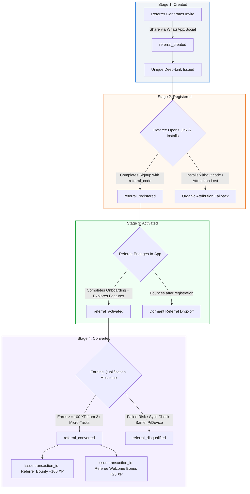
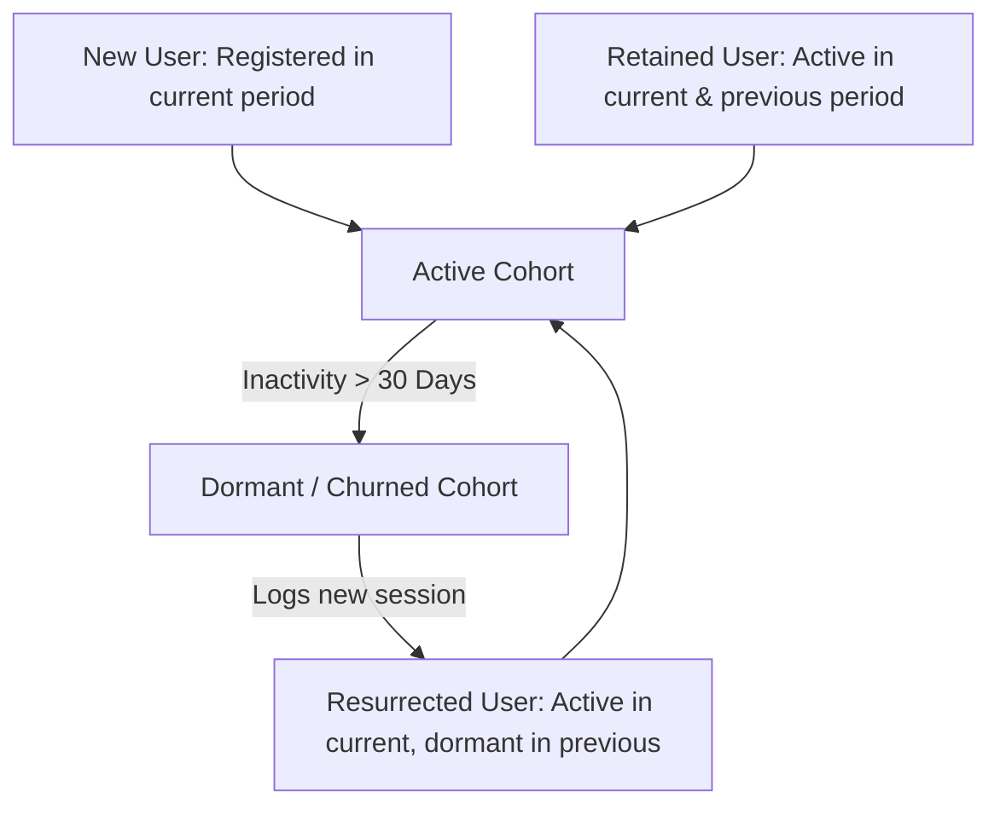

# VELOOP Rewards — Referral & Engagement Analytics Specification

> **CRITICAL GOVERNANCE NOTICE**: All schemas, growth models, viral loops, and engagement frameworks documented in this specification reflect **SIMULATED DATA** created for analytical testing and product architecture modeling. No real user identities, social graphs, or production telemetry were evaluated.

---

## 1. Scope & Objective

This specification establishes the analytics architecture for the viral referral engine and long-term user engagement measurement across VELOOP Rewards. It governs:
- The directional **Referral Relationship Model** mapping referrers to referred users.
- The 4-stage viral progression: **Created $\rightarrow$ Registered $\rightarrow$ Activated $\rightarrow$ Converted**.
- An explicit architectural mandate distinguishing nominal registrations from qualified commercial conversions (**Registration $\neq$ Conversion**).
- Field-level telemetry schemas for referral tracking, invite attribution, and reward qualification.
- The core **Engagement Metrics Framework** spanning Feature Adoption, Repeat Usage, Task Activity Depth, Daily Stickiness (DAU/MAU), and Cohort Retention Dynamics (New, Retained, Resurrected, Churned).
- Explicit governance designations categorizing all elements as `Confirmed`, `Proposed`, or `To Be Verified`.

---

## 2. Core Telemetry Identifiers & Identity Linkage

To maintain strict attribution integrity across viral invitation trees, user activity sessions, and bounty payouts, the following six core identifiers are required across all referral and engagement events:

| Identifier | Format / Type | Scope & Persistence | Why This ID is Needed | Status |
| :--- | :--- | :--- | :--- | :---: |
| **`user_id`** | String (`VLUSR000001` or UUIDv4) | Global, immutable lifetime entity | **Why this ID is needed**: Uniquely binds both the referrer (inviter) and referee (invited) to their lifetime behavioral histories, task completions, and account states. | Confirmed |
| **`event_id`** | String (`EVT00000001` or UUIDv4) | Unique atomic telemetry record | **Why this ID is needed**: Logs discrete interaction milestones (e.g., invite link generated, deep link opened, referral code applied) for funnel conversion tracking. | Confirmed |
| **`session_id`** | String (`SESS0000001` or UUIDv4) | Ephemeral session visit container | **Why this ID is needed**: Tracks the exact session where a referee installs and first launches the application, preserving attribution continuity. | Confirmed |
| **`transaction_id`** | String (`TXN_UUIDv4`) | Immutable double-entry ledger entry | **Why this ID is needed**: Links referral commission and bonus credits to the immutable double-entry wallet ledger. | Proposed |
| **`referral_id`** | String (`REF_UUIDv4`) | Growth attribution graph link | **Why this ID is needed**: Serves as the primary key for the directional referral relationship graph, anchoring timestamps, status transitions, and fraud scoring. | Proposed |
| **`withdrawal_id`** | String (`WDL_UUIDv4`) | Cash disbursement transaction | **Why this ID is needed**: Correlates whether users acquired via referral channels progress to legitimate cash disbursements vs. churning prior to cash-out. | Proposed |

---

## 3. Referral Funnel State Machine & Architecture

The referral journey is a gated multi-stage funnel designed to incentivize high-quality organic user acquisition while preventing sybil farming and programmatic bot abuse:

### 3.1 Funnel Stage Definitions

1. **`Created` (`referral_created`)**:
   - The referrer initiates an outbound invitation via the app UI, generating a unique deep link and referral code.
   - Telemetry tracks outbound sharing channel (`WhatsApp`, `Telegram`, `Instagram`, `Direct Link`).

2. **`Registered` (`referral_registered`)**:
   - The referred user downloads the application, enters the referral code (or has it automatically populated via deep-link parameters), and successfully completes account registration.
   - **Critical State Note**: No monetary or XP bounties are distributed at this stage.

3. **`Activated` (`referral_activated`)**:
   - The referred user completes the introductory onboarding flow and engages in their first authenticated session.
   - Demonstrates genuine human installation and basic product orientation.

4. **`Converted` (`referral_converted`)**:
   - The referred user achieves the defined commercial qualification threshold: earns $\ge 100$ XP through legitimate task completions (e.g., ads watched, surveys answered, daily rewards claimed) across at least two distinct active calendar days.
   - Both the referrer and referee receive their respective bonus credits posted directly to the double-entry wallet ledger.

---

## 4. CRITICAL GOVERNANCE ALERT: Registration $\neq$ Conversion

> [!CAUTION]
> ### Registration is NOT Conversion: The Anti-Fraud Principle
> 
> In mobile rewards products, **attributing and paying out referral bounties immediately upon account registration is a fatal vulnerability**. 
> 
> Unscrupulous actors exploit registration-based bounties using disposable emails, SMS verification bypasses, and Android emulators to generate thousands of fake accounts. Rewarding pure registrations leads to rapid treasury depletion, inflated vanity metrics, and zero downstream advertising revenue.
> 
> **Production Policy Mandate**:
> 1. **Registration is an Acquisition Milestone**: Indicates only that a device installed the app and created credentials.
> 2. **Conversion is a Value-Generating Milestone**: Requires the referee to generate real advertising or task revenue for the platform prior to releasing bounty escrow.
> 3. **Conversion Qualification Gates**:
>    - **Earning Threshold**: Referee must accumulate a minimum of 100 XP strictly through micro-tasks (`Watch Ads`, `Offers`, `Surveys`). Promotional sign-up bonuses do NOT count toward this threshold.
>    - **Activity Diversity**: Referee must interact with at least two distinct platform features.
>    - **Sybil Defense Clearance**: Referrer and referee cannot share the same hardware device ID, local IP subnet, or payment withdrawal VPA.
>    - **Temporal Gate**: Referee must maintain active status across at least 48 hours to eliminate one-click bot farming.

### 4.1 Comparative Architectural Matrix

| Metric Dimension | Registration Milestone (`referral_registered`) | Conversion Milestone (`referral_converted`) |
| :--- | :--- | :--- |
| **User Action Required** | Fill form, enter OTP / Google Sign-In | Complete $\ge 3$ tasks, earn $\ge 100$ XP, return on Day 2+ |
| **Financial Consequence** | Zero ledger movement (Nominal lead tracked) | Escrow released; bounty credited to both wallets |
| **Fraud Vulnerability** | Extremely High (Scriptable, virtual phone numbers) | Very Low (Requires substantial manual or bot compute effort) |
| **Commercial Reality** | Gross user acquisition cost incurred | Platform revenue realized before bounty paid |
| **Reporting Category** | Top-of-Funnel Viral Reach | Bottom-of-Funnel Unit Economics & CAC |

---

## 5. Referral Field Requirement Table

This table specifies the telemetry and database schema fields required for the directional referral relationship model.

| Field | Type | Required | Purpose | Source | Validation | Status |
| :--- | :--- | :---: | :--- | :--- | :--- | :---: |
| `referral_id` | String | Yes | Unique global identifier for referral instance | Referral Engine | Format `REF_` + UUIDv4; unique, non-null | Proposed |
| `referrer_user_id` | String | Yes | User ID of the inviting party | Auth Context | Must exist in `01_Users_1000`; non-null | Confirmed |
| `referred_user_id` | String | Conditional | User ID of the invited party | Auth Context | Must exist in `01_Users_1000`; null before registration | Confirmed |
| `referral_code` | String | Yes | Code entered or captured via deep link | Referral Engine | Format `VL` + 6 hex chars; matches referrer | Confirmed |
| `created_at` | Datetime | Yes | Timestamp invite link was generated | Server Clock (UTC) | ISO-8601 (`YYYY-MM-DDTHH:MM:SS.sssZ`) | Proposed |
| `registered_at` | Datetime | Conditional | Timestamp referee created account | Auth Service | ISO-8601; required if registered; $\ge created\_at$ | Proposed |
| `activated_at` | Datetime | Conditional | Timestamp referee completed onboarding | Onboarding Engine | ISO-8601; required if activated; $\ge registered\_at$ | Proposed |
| `converted_at` | Datetime | Conditional | Timestamp referee met qualification criteria | Milestone Engine | ISO-8601; required if converted; $\ge activated\_at$ | Proposed |
| `status` | Categorical | Yes | Macro operational lifecycle state | Referral Engine | Controlled list: `Created`, `Registered`, `Activated`, `Converted`, `Disqualified` | Proposed |
| `source_channel` | Categorical | Yes | High-level viral sharing platform | Deep Link Tracker | Controlled list: `WhatsApp`, `Telegram`, `Direct_Link`, `Social_Media`, `Organic` | Confirmed |
| `sub_channel` | String | Conditional | Granular campaign or placement sub-tag | UTM Parameters | Max 100 chars; e.g., `whatsapp_story`, `telegram_group` | Proposed |
| `referrer_bounty_xp`| Integer | Conditional | Bounty credited to referrer upon conversion | Reward Engine | Default: 100 XP; strictly positive if converted | Proposed |
| `referred_bonus_xp` | Integer | Conditional | Welcome bonus credited to referee upon conversion | Reward Engine | Default: 25 XP; strictly positive if converted | Proposed |
| `transaction_id` | String | Conditional | Wallet ledger link for referrer bounty credit | Wallet Engine | Required if `status = 'Converted'`; format `TXN_UUIDv4` | Proposed |
| `risk_score` | Float | Yes | Anomaly detection score for referral pair | Anti-Fraud Engine | Float between `0.00` (legitimate) and `1.00` (flagged) | Proposed |
| `disqualification_reason`| Categorical| Conditional| Diagnostic reason if referral rejected | Anti-Fraud Engine | Controlled list: `SAME_DEVICE`, `IP_COLLISION`, `SUSPECTED_BOT`, `TIME_LIMIT_EXCEEDED` | Proposed |

---

## 6. Comprehensive Engagement Metrics Framework

User retention and platform monetization depend on sustained behavioral engagement. The following six measurement pillars constitute the VELOOP engagement analytics framework:

### 6.1 Feature Adoption Rate
Measures the percentage of active users who engage with a specific platform feature over a given time horizon:
$$\text{Feature Adoption Rate} = \frac{\text{Distinct Users Using Feature in Period } t}{\text{Total Active Users in Period } t} \times 100$$
- **Telemetry Dependencies**: `user_id`, `feature_name`, `event_datetime` from `02_Feature_Events`.
- **Target Threshold**: Core features (`Daily Reward`, `Watch Ads`) target $> 70\%$ adoption; specialized features (`Mining`, `Exchange`) target $25\%–40\%$.

### 6.2 Repeat Usage Frequency
Quantifies how frequently retained users return within a single day and across rolling weekly intervals:
$$\text{Mean Daily Sessions per Active User} = \frac{\text{Total Sessions Logged in Day } d}{\text{Distinct Active Users in Day } d}$$
$$\text{Inter-Session Interval (Hours)} = \text{MEDIAN}(session\_start_{i} - session\_start_{i-1})$$
- **Telemetry Dependencies**: `session_id`, `user_id`, `session_start` from `03_User_Sessions`.
- **Target Threshold**: High-retention users average $\ge 2.5$ sessions per day with median inter-session intervals of $4.0–6.0$ hours.

### 6.3 Task Activity Depth
Measures engagement intensity and productivity during user sessions:
$$\text{Task Completion Intensity} = \frac{\text{Total Completed Tasks in Period } t}{\text{Distinct Users Completing Tasks in Period } t}$$
$$\text{Task Diversity Index} = \text{COUNT\_DISTINCT}(task\_type) \text{ per User}$$
- **Telemetry Dependencies**: `task_id`, `task_type`, `user_id`, `status` from `04_Task_Activity`.
- **Analytical Purpose**: Identifies whether users are one-dimensional (e.g., ad watchers only) or multifaceted earners (ads, offers, surveys, daily spins).

### 6.4 Daily Activity Stickiness (DAU/MAU Ratio)
The gold standard ratio for consumer application habituation and retention stickiness:
$$\text{Platform Stickiness} = \frac{\text{Daily Active Users (DAU)}}{\text{Monthly Active Users (MAU)}} \times 100$$
- **Telemetry Dependencies**: Rolling 30-day distinct active user window from user session logs.
- **Benchmark Interpretation**:
  - $< 10\%$: Low engagement / high churn risk.
  - $10\%–20\%$: Typical utility / casual gaming benchmark.
  - $> 20\%$: Strong habituation and viral stickiness.

### 6.5 Active Users Spectrum (DAU, WAU, MAU)
To avoid ambiguous reporting, VELOOP establishes a strict definition of an "Active User":
- **Definition of "Active"**: A user who authenticates and performs at least one non-trivial interaction event (e.g., clicks feature, claims reward, starts task) within the measurement window. Passive background syncs or push receipt pings do NOT qualify.
- **DAU**: Distinct qualified users active within a single calendar day (00:00:00 to 23:59:59 UTC).
- **WAU**: Distinct qualified users active across rolling 7 calendar days.
- **MAU**: Distinct qualified users active across rolling 30 calendar days.

### 6.6 User State Dynamics: Returning vs. Resurrected Users
To understand churn, reactivation, and growth momentum, users are segmented into dynamic lifecycle states:

- **New Users**: Registered within the current reporting period.
- **Retained Users**: Active in the current period and also active in the immediately preceding period.
- **Resurrected Users**: Active in the current period after $\ge 30$ consecutive days of complete dormancy.
- **Churned / Dormant Users**: Users with zero logged sessions for $> 30$ consecutive days.

---

## 7. Governance Classification: Confirmed vs. Proposed vs. To Be Verified

> [!IMPORTANT]
> **Explicit Implementation Classification Callouts**:
>
> 1. **Confirmed Elements (Implemented in Simulated Baseline)**:
>    - Primary user identity attribution (`user_id`).
>    - Inbound attribution channel categorization (`acquisition_source = 'Referral'`).
>    - High-level referral source details (`referral_source_detail = 'Friend/Family'`).
>    - Feature event telemetry for referral screen views (`02_Feature_Events`).
>
> 2. **Proposed Elements (Required for Production Architecture)**:
>    - Dedicated directional referral relationship table (`referral_id`, `referrer_user_id`, `referred_user_id`, timestamps, status).
>    - Strict 4-stage referral funnel (`Created`, `Registered`, `Activated`, `Converted`).
>    - Architectural enforcement of the **Registration $\neq$ Conversion** qualification gate.
>    - Dual-sided bounty ledger distribution model (`referrer_bounty_xp`, `referred_bonus_xp`).
>    - Referral anti-fraud risk scoring and device collision disqualification reasons.
>
> 3. **To Be Verified (Requires Engineering & Business Alignment)**:
>    - Exact qualification threshold for conversion (proposed as 100 XP from 3 distinct tasks; to be calibrated against initial product unit economics).
>    - Multi-tier referral revenue share: Whether referrers should receive lifetime secondary commissions (e.g., 5% of referee's ongoing task earnings) in addition to the flat conversion bounty.
>    - Deep-link deferred attribution provider selection (Branch.io vs. AppsFlyer OneLink vs. Firebase Dynamic Links).

---

## Data Authenticity Statement
This referral and engagement analytics specification was prepared using simulated data created for analytical testing and product architecture modeling. No real user identities, personal contact details, social network connections, or production referral records were accessed, analyzed, or included. All metrics, conversion funnels, and retention models reflect simulated test environments.
