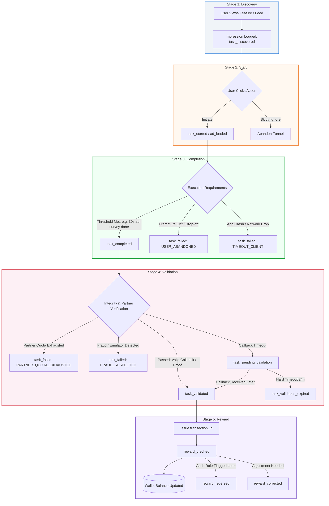
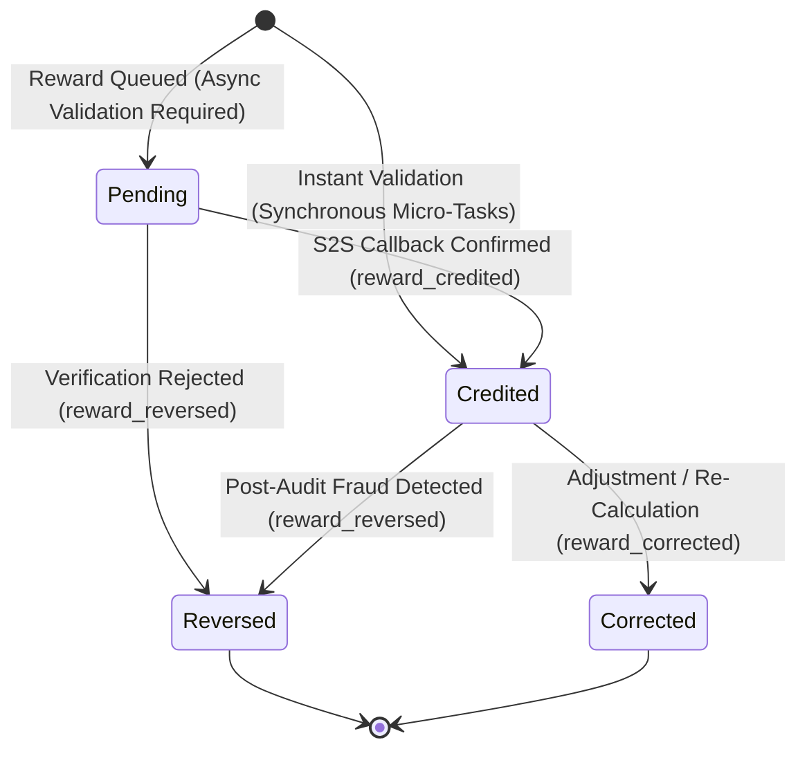
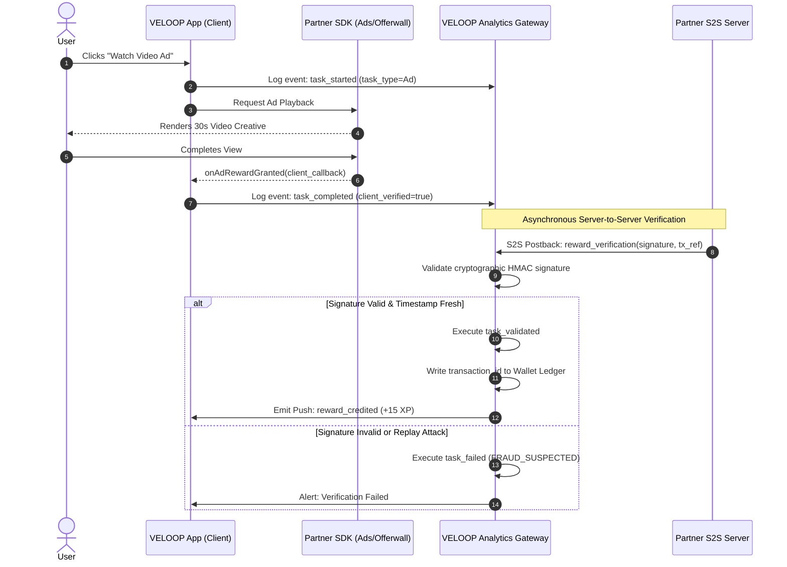

# VELOOP Rewards — Reward & Micro-Task Analytics Specification

> **CRITICAL GOVERNANCE NOTICE**: All schemas, entity models, and telemetry specifications documented in this specification reflect **SIMULATED DATA** created for analytical testing and product architecture modeling. No real production data or partner API keys were evaluated.

---

## 1. Scope & Objective

This specification governs the end-to-end analytics architecture for reward generation, task execution, and credit disbursements across VELOOP Rewards. It establishes:
- The telemetry lifecycle for all micro-earning mechanisms, including **Watch Ads & Offers**, **Daily Rewards**, **Tap & Earn**, **Mining Simulator**, **Spin & Win**, **Custom Tasks**, and **Milestone Missions**.
- The canonical 5-stage earning progression: **Discovery $\rightarrow$ Start $\rightarrow$ Completion $\rightarrow$ Validation $\rightarrow$ Reward**.
- Field-level instrumentation schemas for task execution logs, validation engines, and reward ledger events.
- A standardized, structured failure classification taxonomy to diagnose conversion drop-offs without reliance on opaque third-party codes.
- Telemetry contracts for external third-party dependencies (ad mediation SDKs, offerwalls, survey providers, casual game SDKs, and attribution trackers).
- Formal governance classifications designating all elements as `Confirmed`, `Proposed`, or `To Be Verified`.

---

## 2. Core Telemetry Identifiers & Cross-Domain Linkage

To ensure absolute auditability from an initial user screen view down to an irrevocable ledger entry, the following six core identifiers are required across all reward events:

| Identifier | Format / Type | Scope & Persistence | Why This ID is Needed | Status |
| :--- | :--- | :--- | :--- | :---: |
| **`user_id`** | String (`VLUSR000001` or UUIDv4) | Global, immutable lifetime entity | **Why this ID is needed**: Associates task participation, streak progression, and reward credits to the permanent user profile. | Confirmed |
| **`event_id`** | String (`EVT00000001` or UUIDv4) | Unique atomic telemetry record | **Why this ID is needed**: Captures discrete client/server interaction events (e.g., task started, ad impression logged) for idempotency and stream processing. | Confirmed |
| **`session_id`** | String (`SESS0000001` or UUIDv4) | Ephemeral session visit container | **Why this ID is needed**: Ties task discovery and execution to specific user visit sessions for dwell time and flow optimization. | Confirmed |
| **`transaction_id`** | String (`TXN_UUIDv4`) | Immutable double-entry ledger entry | **Why this ID is needed**: Uniquely binds a validated task reward payout to the immutable double-entry wallet ledger. | Proposed |
| **`referral_id`** | String (`REF_UUIDv4`) | Growth attribution graph link | **Why this ID is needed**: Connects secondary referral tier task commissions (kickbacks) back to the original referral tree link. | Proposed |
| **`withdrawal_id`** | String (`WDL_UUIDv4`) | Cash disbursement transaction | **Why this ID is needed**: Tracks when accumulated reward XP is converted and queued for fiat payout disbursement. | Proposed |

---

## 3. Earning Lifecycle State Machine & Funnel

The earning lifecycle represents the critical conversion funnel of the VELOOP platform. Every reward opportunity transitions through five deterministic states:

### 3.1 Funnel Stage Definitions

1. **Discovery Stage (`task_discovered`)**:
   - The user opens a feature surface (e.g., Task Hub, Offerwall, Spin Wheel) and receives impressions of available earning opportunities.
   - Measures catalog reach, placement CTR, and offer presentation inventory.

2. **Start Stage (`task_started`)**:
   - The user actively engages with an opportunity (e.g., taps "Start Survey", launches rewarded video ad, taps the mining button).
   - Establishes the execution baseline timestamp and locks active concurrency limits.

3. **Completion Stage (`task_completed`)**:
   - The user finishes the client-side engagement requirement (e.g., ad playback completes, survey redirect triggers, mining cycle timer expires).
   - Telemetry must record client completion parameters before hand-off to verification.

4. **Validation Stage (`task_validated` or `task_failed`)**:
   - The system verifies the legitimacy of the completion. This involves server-to-server (S2S) postback verification from third-party partners, anti-sybil checks, and device integrity validation.
   - For internal micro-actions (e.g., Daily Spin, Tap & Earn), validation is executed synchronously within the platform backend (<100ms).

5. **Reward Stage (`reward_credited`)**:
   - Upon successful validation, the reward engine posts an immutable credit transaction to the user's wallet ledger, incrementing both lifetime earned XP and current spendable balance.

---

## 4. Task-Level Field Requirement Table

This table specifies the telemetry fields required for each task interaction event across the platform.

| Field | Type | Required | Purpose | Source | Validation | Status |
| :--- | :--- | :---: | :--- | :--- | :--- | :---: |
| `task_id` | String | Yes | Unique identifier for the individual task instance | Task Service | Format `TSK` + 7 digits or UUIDv4; unique | Confirmed |
| `task_type` | Categorical | Yes | Functional category of the earning activity | Feature Catalog | Controlled list: `Ad`, `Survey`, `Daily_Reward`, `Tap`, `Mining`, `Spin`, `App_Install`, `Social_Follow` | Confirmed |
| `feature` | Categorical | Yes | Product surface hosting the task | UI Navigation | Controlled list of 15 features (e.g., `Watch Ads / Offers`, `Tap & Earn`, `Spin`) | Confirmed |
| `user_id` | String | Yes | Foreign key to the participating user | Auth Context | Must exist in `01_Users_1000`; non-null | Confirmed |
| `session_id` | String | Yes | Session container where task was initiated | Client Telemetry | Must exist in session registry | Confirmed |
| `start_time` | Datetime | Yes | Exact task launch timestamp | Client / Server (UTC) | ISO-8601 (`YYYY-MM-DDTHH:MM:SS.sssZ`) | Confirmed |
| `completion_time` | Datetime | Conditional | Timestamp when client reported completion | Client / Server (UTC) | Required if `status = 'Completed'`; $\ge start\_time$ | Confirmed |
| `duration_seconds` | Integer | Conditional | Total elapsed execution duration | Derived | Required if `completion_time` present; integer $\ge 0$ | Confirmed |
| `status` | Categorical | Yes | Macro operational execution status | Task Engine | Controlled list: `Completed`, `Failed`, `In_Progress`, `Abandoned` | Confirmed |
| `reward_amount` | Integer | Yes | XP reward value associated with task | Reward Engine | Integer $\ge 0$; non-negative | Confirmed |
| `reward_unit` | Categorical | Yes | Denomination unit of reward | Reward Engine | Controlled list: `XP`, `Points`, `INR` (Default: `XP`) | Confirmed |
| `validation_status` | Categorical | Yes | Verification outcome of task requirements | Validation Engine | Controlled list: `Validated`, `Pending`, `Rejected`, `Exempt` | Confirmed |
| `partner_id` | String | Conditional | Third-party vendor identifier | Partner SDK | Required for ad, offer, and survey tasks; e.g., `ADMOB_01`, `BITLABS_02` | Proposed |
| `partner_campaign_id`| String | Conditional | External campaign / offer reference | Partner Postback | Alphanumeric string; null for internal tasks | Proposed |
| `failure_category` | Categorical | Conditional | Diagnostic root-cause categorization | Error Handler | Controlled list (see Section 6); required if `status = 'Failed'` | Proposed |
| `failure_reason` | String | Conditional | Human-readable diagnostic description | Telemetry / SDK | Max 255 chars; sanitized; null if status is Completed | Confirmed |
| `transaction_id` | String | Conditional | Wallet ledger link for credited payouts | Wallet Engine | Required if `validation_status = 'Validated'`; format `TXN_UUIDv4` | Proposed |
| `device_integrity_score` | Float | Proposed | Risk assessment score at task completion | Risk Engine | Float between `0.00` (high risk) and `1.00` (trusted) | Proposed |

---

## 5. Reward Events Schema & State Machine

Reward issuance must adhere to financial ledger principles. The reward lifecycle is governed by four deterministic event states:

### 5.1 Reward Event Specifications

1. **`reward_credited`**:
   - **Trigger**: Emitted the exact instant XP is permanently committed to a user's wallet balance.
   - **Payload**: Contains `transaction_id`, `user_id`, `task_id`, `amount`, `unit`, `ledger_timestamp`, and `balance_after`.
   - **State Effect**: Increases `xp_balance` and `lifetime_earned_xp`.

2. **`reward_pending`**:
   - **Trigger**: Emitted when a high-value task (e.g., $10$ survey or complex offerwall milestone) is completed but awaits asynchronous third-party reconciliation or manual review.
   - **Payload**: Contains `hold_id`, `user_id`, `task_id`, `expected_amount`, and `review_deadline`.
   - **State Effect**: Does not increase spendable `xp_balance`; tracked under `pending_xp_escrow`.

3. **`reward_reversed`**:
   - **Trigger**: Emitted when a previously credited reward is clawed back due to confirmed attribution fraud, chargeback from an advertising partner, or duplicate credit processing.
   - **Payload**: Contains `reversal_id`, `original_transaction_id`, `user_id`, `clawback_amount`, `reason`, and `reversal_timestamp`.
   - **State Effect**: Deducts XP from spendable balance; logs an offsetting negative ledger entry.

4. **`reward_corrected`**:
   - **Trigger**: Emitted when an arithmetic mismatch, currency conversion variance, or partial reward adjustment occurs.
   - **Payload**: Contains `correction_id`, `original_transaction_id`, `user_id`, `net_delta_amount`, `correction_type` (`ADD` or `SUBTRACT`), and `authorizer`.
   - **State Effect**: Adjusts spendable balance to match corrected ledger truth.

---

## 6. Structured Failure Classification Taxonomy

To resolve the governance issue where failures are either obscured or labeled with arbitrary internal codes, VELOOP adopts a structured diagnostic taxonomy. 

> [!NOTE]
> All failure classifications below **are proposed as** the standardized error taxonomy for production ingestion.

| Failure Category | Failure Code | Description | Origin / Responsible Layer | Actionable Remediation | Status |
| :--- | :--- | :--- | :--- | :--- | :---: |
| **Technical** | `TIMEOUT_CLIENT` | Client app failed to report completion within expected timeout window | Client SDK / Network | Optimize client retry queue; assess network latency | Proposed |
| **Technical** | `TIMEOUT_PARTNER_CALLBACK` | Third-party postback was not received within the 24-hour grace window | Partner Postback Engine | Flag partner SLA breach; auto-expire pending escrow | Proposed |
| **Technical** | `ASSET_LOAD_FAILURE` | Video ad creative, survey iframe, or task asset failed to render | CDN / Mediation Network | Fallback to secondary ad network mediation waterfall | Proposed |
| **Technical** | `NETWORK_DISCONNECT` | Socket or HTTP stream dropped during task interaction | Client Network Layer | Cache offline progress if task type permits | Proposed |
| **Partner Inventory** | `PARTNER_QUOTA_EXHAUSTED` | Partner daily budget or impression cap was reached mid-execution | Partner Ad Server | Deprioritize campaign in dynamic offer catalog | Proposed |
| **Partner Inventory** | `OFFER_NO_INVENTORY` | No eligible ads or surveys available for user's demographic cohort | Mediation Engine | Present fallback house ads or native gamified tasks | Proposed |
| **Partner Inventory** | `SURVEY_SCREEN_OUT` | User disqualified during initial survey demographic screening | Survey Provider | Route user to alternate survey; award consolation XP | Proposed |
| **User Abandonment** | `ABANDONED_PREMATURE_EXIT` | User closed the task modal or navigated away before meeting threshold | User UI Action | Analyze UX friction and task instruction clarity | Proposed |
| **User Abandonment** | `SESSION_EXPIRED` | User session timed out due to prolonged inactivity during task | Session Manager | Prompt user with session keep-alive modal | Proposed |
| **Integrity & Fraud** | `DUPLICATE_CLAIM_ATTEMPT` | User attempted to claim an already awarded one-time milestone | Anti-Replay Engine | Block duplicate credit; log security alert | Proposed |
| **Integrity & Fraud** | `EMULATOR_FLAGGED` | Task execution environment identified as headless browser or emulator | Risk / Device SDK | Suppress reward; flag account for fraud review | Proposed |
| **Integrity & Fraud** | `GEO_MISMATCH` | Client IP geolocation contradicts target campaign region | Geolocation Service | Invalidate impression; update catalog geo-filter | Proposed |
| **Integrity & Fraud** | `CLICK_SPAM_DETECTED` | Task completed in an impossibly fast timeframe (bot automation) | Anomaly Detector | Discard completion; enforce CAPTCHA verification | Proposed |
| **Validation** | `PROOF_MISMATCH` | Submitted screenshot or verification proof failed OCR/human review | Verification Pipeline | Notify user to re-submit valid task proof | Proposed |
| **Validation** | `REQUIREMENT_UNMET` | User failed to achieve required game level or minimum retention days | Partner MMP Postback | Keep offer in progress until eligibility deadline | Proposed |

---

## 7. Third-Party Dependency Analytics

Modern reward platforms rely heavily on third-party SDKs and server-to-server (S2S) postbacks. Telemetry pipelines must track partner performance, latency, and discrepancy rates to ensure accurate partner reconciliation.

### 7.1 Integration Domain Telemetry Requirements

1. **Ad Mediation Networks (e.g., Google AdMob, Unity Ads, AppLovin MAX)**:
   - **Metrics Tracked**: Ad Request Count, Ad Fill Rate (`Fills / Requests`), Ad Impression Rate, eCPM, Video Completion Rate (`Completed Views / Impressions`), Click-Through Rate (CTR).
   - **Discrepancy Threshold**: Discrepancies between client-reported ad completions and partner billable impressions must not exceed $\pm 3.0\%$.

2. **Offerwalls & Survey Platforms (e.g., BitLabs, Pollfish, Tapjoy, ironSource)**:
   - **Metrics Tracked**: Offerwall Opens, Offer Clicks, Survey Screen-Out Rate, Conversion Rate (`S2S Postbacks / Offer Clicks`), Average Yield per Survey (XP vs. USD margin).
   - **S2S Postback Contract**: Every postback must contain `user_id`, `partner_transaction_id`, `payout_usd`, `xp_calculated`, and `hmac_signature`.

3. **Casual Gaming SDKs (e.g., Adjoe / Playtime)**:
   - **Metrics Tracked**: Time-played events, continuous heartbeat pings (every 60 seconds), level achievement milestones, foreground app focus status.
   - **Validation Requirement**: Pings must verify the target gaming app was in the active operating system foreground.

4. **Mobile Measurement Partners (MMP / Attribution Trackers like AppsFlyer, Adjust)**:
   - **Metrics Tracked**: Install attribution, re-engagement deep-link attribution, click-to-install time (CTIT), probabilistic vs. deterministic attribution match type.

---

## 8. Governance Classification: Confirmed vs. Proposed vs. To Be Verified

> [!IMPORTANT]
> **Explicit Implementation Classification Callouts**:
>
> 1. **Confirmed Elements (Implemented in Simulated Baseline)**:
>    - Primary earning features and event schemas (`02_Feature_Events`, `04_Task_Activity`).
>    - Core identifiers (`task_id`, `task_type`, `feature`, `user_id`, `session_id`, `start_time`, `completion_time`, `status`).
>    - Basic reward attributes (`reward_amount`, `reward_unit`, `validation_status`).
>    - Macro failure reason string (`failure_reason`).
>
> 2. **Proposed Elements (Required for Production Architecture)**:
>    - Standardized structured failure classification taxonomy (`failure_category`, `failure_code`).
>    - Four-state financial reward event lifecycle (`reward_credited`, `reward_pending`, `reward_reversed`, `reward_corrected`).
>    - Partner attribution fields (`partner_id`, `partner_campaign_id`).
>    - Direct ledger linkage keys (`transaction_id`).
>    - Device risk and integrity scoring (`device_integrity_score`).
>
> 3. **To Be Verified (Requires Engineering & Business Alignment)**:
>    - Final S2S postback HMAC signature algorithm (SHA-256 vs. ED25519) and shared signing key rotation schedule with offerwall providers.
>    - Maximum allowable duration for pending escrow holds (proposed as 72 hours for high-value surveys before auto-rejection).
>    - Exact XP-to-Fiat conversion peg ratio across third-party ad yields (current simulated data models 10 XP $\approx$ ₹1 INR).

---

## Data Authenticity Statement
This reward analytics specification was prepared using simulated data created for analytical testing and product architecture modeling. No real production data, partner credentials, advertising revenue figures, or user reward balances were accessed, analyzed, or included. All metrics, completion rates, and failure distributions reflect simulated test environments.
