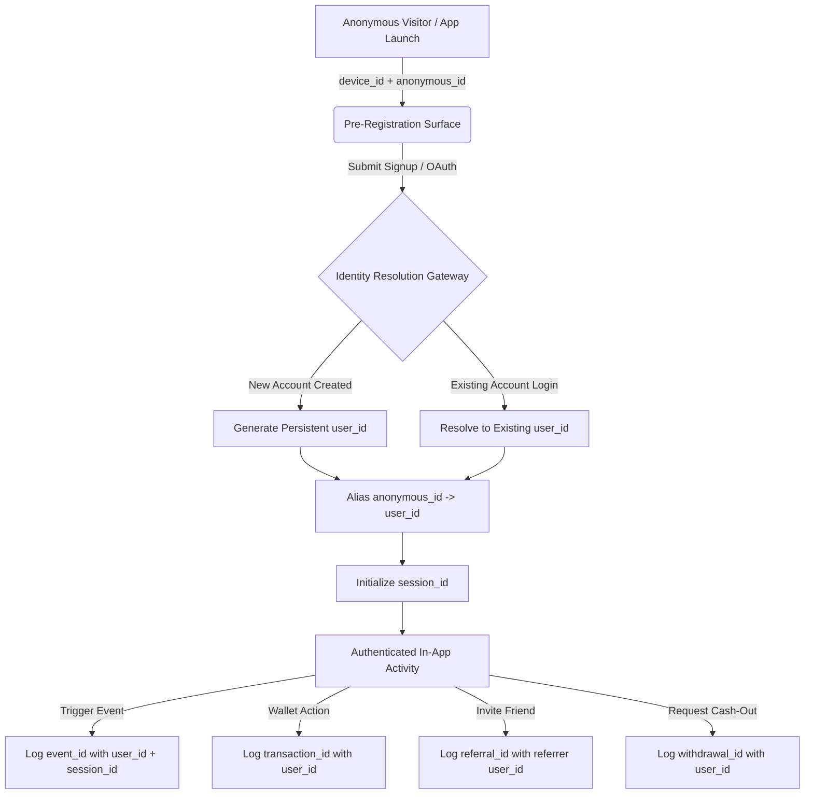
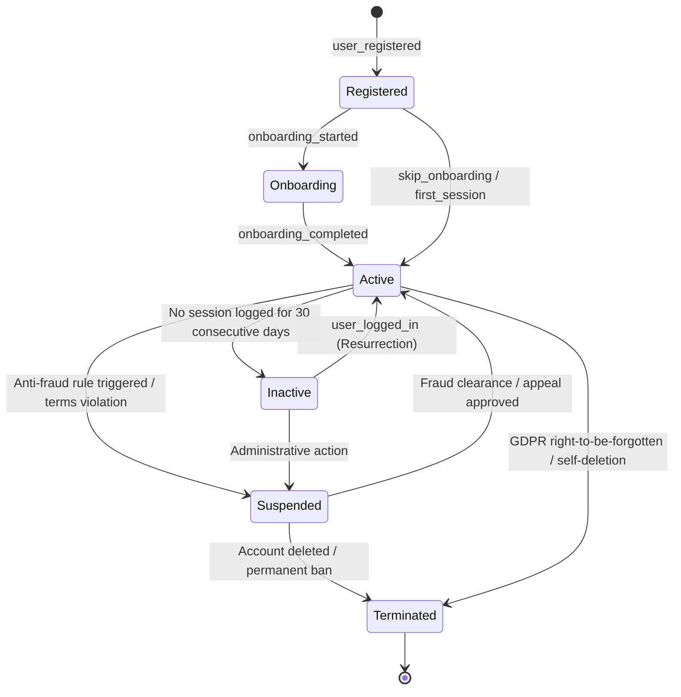

# VELOOP Rewards — User Analytics Specification

> **CRITICAL GOVERNANCE NOTICE**: All schemas, entity models, and telemetry specifications documented in this specification reflect **SIMULATED DATA** created for analytical testing and product architecture modeling. No real production data or user PII was evaluated.

---

## 1. Scope & Objective

This specification establishes the canonical identity, session, and lifecycle analytics architecture for VELOOP Rewards. It defines:
- The persistent user identity model spanning pre-registration and authenticated states.
- Telemetry contracts for **Registration**, **Authentication (Login)**, **Onboarding**, and **Account Lifecycle States**.
- Mandatory identifier requirements, field validation rules, and lifecycle transition logic.
- Governance standards categorizing all attributes as `Confirmed`, `Proposed`, or `To Be Verified`.

---

## 2. Core Telemetry Identifiers & Identity Model

To maintain unambiguous referential integrity across analytical, session, and financial domains, the following six primary identifiers are required:

| Identifier | Format / Type | Scope & Persistence | Why This ID is Needed | Status |
| :--- | :--- | :--- | :--- | :---: |
| **`user_id`** | String (`VLUSR000001` or UUIDv4) | Global, immutable lifetime entity | **Why this ID is needed**: Serves as the single source of truth for user entity attribution across all sessions, events, tasks, wallet balances, and cohort analyses. | Confirmed |
| **`session_id`** | String (`SESS0000001` or UUIDv4) | Ephemeral session container | **Why this ID is needed**: Groups atomic clickstream events into discrete engagement visits, enabling bounce rate, session duration, and journey pathing analysis. | Confirmed |
| **`event_id`** | String (`EVT00000001` or UUIDv4) | Unique atomic telemetry record | **Why this ID is needed**: Guarantees stream processing idempotency, deduplication at the ingestion gateway, and auditability of individual user interactions. | Confirmed |
| **`transaction_id`** | String (`TXN_UUIDv4`) | Immutable double-entry ledger entry | **Why this ID is needed**: Provides immutable auditability for every XP and fiat balance change, preventing balance discrepancies and enabling financial reconciliation. | Proposed |
| **`referral_id`** | String (`REF_UUIDv4`) | Growth attribution graph link | **Why this ID is needed**: Maps the directional viral relationship between referrer and referee, tracking invite delivery, attribution qualification, and bounty disbursement. | Proposed |
| **`withdrawal_id`** | String (`WDL_UUIDv4`) | Cash disbursement transaction | **Why this ID is needed**: Tracks external payout lifecycle states with payment gateways (UPI, IMPS), managing escrow states, timeouts, and fraud reviews. | Proposed |

---

### Identity Resolution & State Transition Architecture

> [!NOTE]
> **Identity Resolution Rule**: When an anonymous user registers, the client telemetry SDK must immediately emit an `alias_identified` event linking the local client `anonymous_id` to the newly issued `user_id`. All retroactive pre-registration events are attributed to the identified user profile in the Silver data layer.

---

## 3. Account Lifecycle State Machine

Users transition through distinct lifecycle states based on authentication, activity frequency, and administrative or security actions:

---

## 4. Minimum Field Requirement Tables by Lifecycle Stage

### 4.1 Registration Stage
Tracks the conversion of an anonymous visitor into an identified platform member.

| Field | Type | Required | Purpose | Source | Validation | Status |
| :--- | :--- | :---: | :--- | :--- | :--- | :---: |
| `user_id` | String | Yes | Unique global identifier | Auth Service / DB | Prefix `VLUSR` + 6 digits or UUIDv4; unique, non-null | Confirmed |
| `full_name` | String | Yes | Display name for personalization | User Form Input | Length 2–100 characters; stripped of whitespace | Confirmed |
| `email` | String | Yes | Primary communication and login identifier | User Form Input | RFC 5322 regex validation; lowercase normalized | Confirmed |
| `age` | Integer | Yes | Age verification for compliance | User Form Input | Integer $\ge 18$ (rewards platform legal threshold) | Confirmed |
| `gender` | Categorical | Optional | Demographic segmentation | User Form Input | Controlled list: `Male`, `Female`, `Other` | Confirmed |
| `state` | Categorical | Yes | Regional geographic analysis | User Form Input / IP | Controlled list of 28 Indian States & 8 UTs | Confirmed |
| `city` | Categorical | Yes | Urban vs. rural engagement analysis | User Form Input / IP | Non-empty string; validated against state | Confirmed |
| `registration_datetime` | Datetime | Yes | Baseline account creation timestamp | Server Clock (UTC) | ISO-8601 (`YYYY-MM-DDTHH:MM:SS.sssZ`); monotonic | Confirmed |
| `acquisition_source` | Categorical | Yes | Attribution channel categorization | UTM / Ingress Header | Controlled list: `Organic Search`, `Direct`, `Social Media`, `Referral`, `WhatsApp`, `Telegram`, `Other` | Confirmed |
| `referral_source_detail` | Categorical | Conditional | Granular referral channel sub-type | Referral Param | Required if `acquisition_source = 'Referral'`; e.g., `Friend/Family`, `Influencer`, `Social Post` | Confirmed |
| `primary_device` | Categorical | Yes | Primary client hardware type | User-Agent / Client SDK | Controlled list: `Android`, `iOS`, `Windows`, `macOS` | Confirmed |
| `platform` | Categorical | Yes | Client application framework | Client App Build | Controlled list: `Web`, `Android Native`, `iOS Native` | Confirmed |
| `account_created_via` | Categorical | Yes | Authentication provider utilized | Auth Service | Controlled list: `Web Registration`, `Google Sign-In`, `Phone OTP` | Confirmed |
| `referral_code` | String | Yes | User's issued unique outbound share code | Referral Generator | Alphanumeric string (`VL` + 6 hex characters); unique | Confirmed |
| `consent_status` | Categorical | Yes | DPDP/GDPR privacy compliance | User Checkbox | Controlled list: `Accepted`, `Pending` | Confirmed |
| `marketing_opt_in` | Categorical | Yes | Push and email promotional consent | User Checkbox | Controlled list: `Yes`, `No` | Confirmed |

---

### 4.2 Authentication & Login Stage
Tracks active engagement visits, returning user patterns, and device characteristics.

| Field | Type | Required | Purpose | Source | Validation | Status |
| :--- | :--- | :---: | :--- | :--- | :--- | :---: |
| `session_id` | String | Yes | Unique session visit container | Client SDK / Gateway | Prefix `SESS` + 7 digits or UUIDv4; unique, non-null | Confirmed |
| `user_id` | String | Yes | Foreign key to parent user | Auth Token | Must exist in `01_Users_1000` | Confirmed |
| `session_start` | Datetime | Yes | Visit initialization timestamp | Client / Server (UTC) | ISO-8601; valid timestamp | Confirmed |
| `session_end` | Datetime | Yes | Visit termination timestamp | Client / Server (UTC) | ISO-8601; must be $\ge session\_start$ | Confirmed |
| `session_duration_seconds` | Integer | Yes | Engagement duration of visit | Derived (`end - start`) | Integer $\ge 0$; flagged if $> 86400$ | Confirmed |
| `device` | Categorical | Yes | Hardware operating system | Client SDK | Controlled list: `Android`, `iOS`, `Web` | Confirmed |
| `entry_point` | Categorical | Yes | Surface where user entered app | Deep Link / Router | Controlled list: `Home`, `Daily Reward`, `Tasks`, `Wallet`, `Referral` | Confirmed |
| `exit_feature` | Categorical | Optional | Last surface viewed before exit | App State Router | Controlled list of 15 features; null if abrupt exit | Confirmed |
| `events_in_session` | Integer | Yes | Interaction density in visit | Aggregate Counter | Integer $\ge 0$ | Confirmed |
| `features_used_count` | Integer | Yes | Feature variety breadth | Aggregate Counter | Integer $\ge 0$ and $\le 15$ | Confirmed |
| `session_status` | Categorical | Yes | Technical termination disposition | Gateway Session Mgr | Controlled list: `Completed`, `Timed Out`, `Terminated` | Confirmed |
| `last_login_datetime` | Datetime | Conditional | Timestamp of user's latest login | Auth Service | ISO-8601; $\ge registration\_datetime$ | Confirmed |
| `lifetime_sessions` | Integer | Yes | Cumulative session counter | User Profile Mart | Integer $\ge 0$; increments by 1 per session | Confirmed |

---

### 4.3 Onboarding Stage
Measures the progressive activation funnel and initial user habituation.

| Field | Type | Required | Purpose | Source | Validation | Status |
| :--- | :--- | :---: | :--- | :--- | :--- | :---: |
| `onboarding_status` | Categorical | Yes | Macro activation state | User Profile DB | Controlled list: `Completed`, `Started`, `Not Started` | Confirmed |
| `step_number` | Integer | Proposed | Micro-funnel step sequence index | Onboarding Wizard | Integer $1$ to $5$ | Proposed |
| `step_name` | String | Proposed | Screen/step identifier | Client Router | e.g., `Profile_Setup`, `How_To_Earn`, `Notification_Permission` | Proposed |
| `step_viewed_at` | Datetime | Proposed | Step arrival timestamp | Client Telemetry | ISO-8601 timestamp | Proposed |
| `step_completed_at` | Datetime | Proposed | Step submission timestamp | Client Telemetry | ISO-8601; $\ge step\_viewed\_at$ | Proposed |
| `time_spent_seconds` | Integer | Proposed | Friction / dwell time on step | Derived | Integer $\ge 0$ | Proposed |
| `initial_reward_awarded` | Integer | Proposed | Welcome bonus credited on completion | Wallet Engine | Integer $\ge 0$ (e.g. 50 XP) | Proposed |

---

### 4.4 Account Lifecycle & Engagement Stage
Tracks ongoing retention, habituation streaks, and churn states.

| Field | Type | Required | Purpose | Source | Validation | Status |
| :--- | :--- | :---: | :--- | :--- | :--- | :---: |
| `account_status` | Categorical | Yes | Operational lifecycle disposition | User Management DB | Controlled list: `Active`, `Inactive`, `Suspended`, `Pending Verification` | Confirmed |
| `email_verification_status` | Categorical | Yes | Verified trust tier | Auth Database | Controlled list: `Verified`, `Pending` | Confirmed |
| `active_days` | Integer | Yes | Distinct historical active days | Daily Aggregator | Integer $\ge 0$ and $\le lifetime\_sessions$ | Confirmed |
| `days_since_registration` | Float | Yes | Account age normalized to snapshot | Derived | Float $\ge 0.0$; clamped to zero if negative | Confirmed |
| `is_active_7d` | Categorical | Yes | Rolling 7-day engagement flag | Daily Mart | Controlled list: `Yes`, `No` | Confirmed |
| `is_active_30d` | Categorical | Yes | Rolling 30-day engagement flag | Daily Mart | Controlled list: `Yes`, `No` | Confirmed |
| `streak_count_current` | Integer | Proposed | Unbroken consecutive active days | Daily Mart | Integer $\ge 0$ | Proposed |
| `suspension_reason` | Categorical | Proposed | Regulatory or fraud trigger | Risk Engine | Controlled list: `Multi-Account`, `Emulator_Detected`, `Click_Spam`, `Manual_Review` | Proposed |

---

## 5. Governance Classification: Confirmed vs. Proposed vs. To Be Verified

> [!IMPORTANT]
> **Explicit Implementation Classification Callouts**:
>
> 1. **Confirmed Elements (Implemented in Simulated Baseline)**:
>    - Core demographic attributes (`user_id`, `email`, `age`, `gender`, `state`, `city`).
>    - Primary identifiers (`user_id`, `session_id`, `event_id`).
>    - Macro status fields (`account_status`, `email_verification_status`, `onboarding_status`).
>    - Baseline session telemetry (`session_duration_seconds`, `entry_point`, `exit_feature`).
>
> 2. **Proposed Elements (Required for Production Architecture)**:
>    - Granular step-level onboarding telemetry (`step_name`, `step_number`, `time_spent_seconds`).
>    - Formal double-entry transaction linking identifiers (`transaction_id`).
>    - Growth referral graph identifiers (`referral_id`).
>    - Cash payout identifiers (`withdrawal_id`).
>    - Risk and suspension reason taxonomy (`suspension_reason`).
>
> 3. **To Be Verified (Requires Engineering & Business Alignment)**:
>    - Exact session inactivity timeout window (current simulated dataset uses 300-second session cap; production standard to be confirmed as 15 vs. 30 minutes).
>    - Master list of permitted international phone prefixes and localization formats if expanding beyond India.
>    - Re-activation grace period before permanent account anonymization under DPDP guidelines.

---

## Data Authenticity Statement
This user analytics specification was prepared using simulated data created for analytical testing and product architecture modeling. No real production data or user PII was accessed, analyzed, or included. All metrics, user counts, and behavioral distributions reflect simulated test environments.
