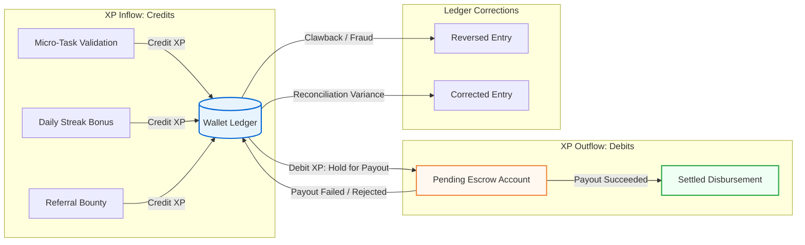
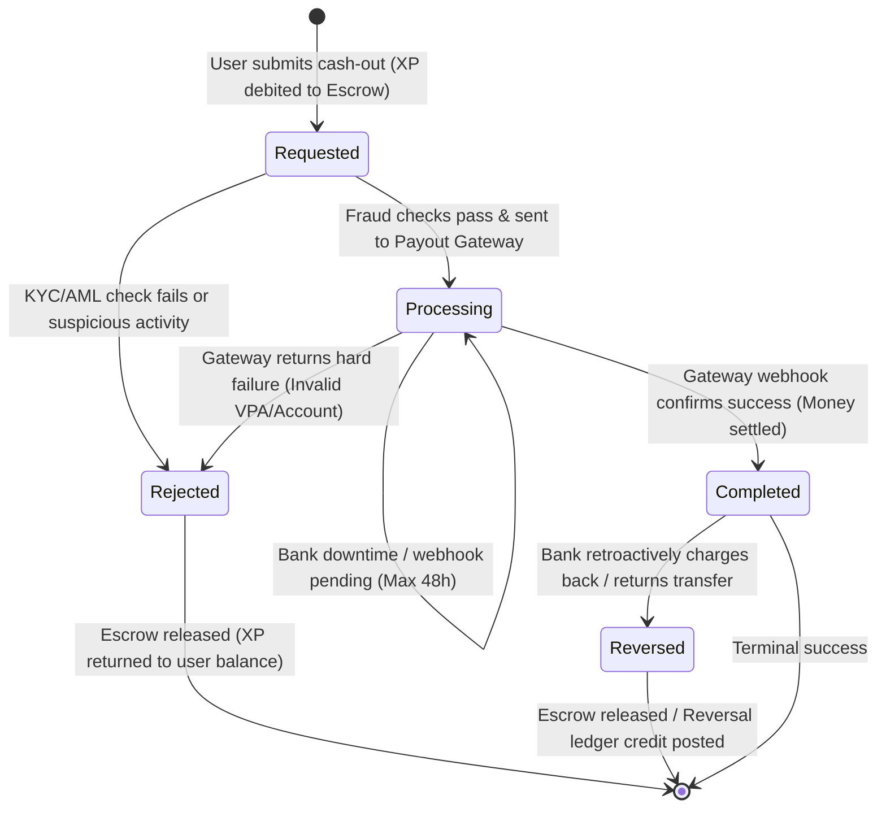

# VELOOP Rewards — Wallet & Withdrawal Analytics Specification

> **CRITICAL GOVERNANCE NOTICE**: All schemas, ledger models, transaction workflows, and KPI definitions documented in this specification reflect **SIMULATED DATA** created for analytical testing and product architecture modeling. No real financial transactions, banking rails, payment gateway credentials, or user balances were evaluated.

---

## 1. Scope & Objective

This specification establishes the financial telemetry architecture, double-entry ledger contracts, and cash disbursement analytics for VELOOP Rewards. It defines:
- The immutable **Wallet Transaction Model** governing XP accruals, conversions, holds, and debits.
- The end-to-end **Withdrawal Lifecycle State Machine** spanning `Requested`, `Processing`, `Completed`, `Rejected`, and `Reversed` payout branches.
- Field-level instrumentation schemas for transaction logs, gateway reconciliation postbacks, and disbursement audits.
- A comprehensive suite of twelve (12) operational and financial **Withdrawal KPIs** tracking gateway SLAs, fraud quarantine velocity, unit economics, and liquidity escrow.
- Explicit governance designations classifying every element as `Confirmed`, `Proposed`, or `To Be Verified`.

---

## 2. Core Telemetry Identifiers & Cross-Domain Linkage

To maintain strict financial auditability and avoid reconciliation gaps between gameplay telemetry and cash disbursement rails, the following six core identifiers are required across all wallet and payout events:

| Identifier | Format / Type | Scope & Persistence | Why This ID is Needed | Status |
| :--- | :--- | :--- | :--- | :---: |
| **`user_id`** | String (`VLUSR000001` or UUIDv4) | Global, immutable lifetime entity | **Why this ID is needed**: Associates all ledger credit and debit entries to the permanent user account and KYC profile. | Confirmed |
| **`event_id`** | String (`EVT00000001` or UUIDv4) | Unique atomic telemetry record | **Why this ID is needed**: Logs discrete user client interactions (e.g., tap "Request Cash-Out") for clickstream auditing and funnel telemetry. | Confirmed |
| **`session_id`** | String (`SESS0000001` or UUIDv4) | Ephemeral session visit container | **Why this ID is needed**: Connects cash-out requests to specific user authentication sessions to detect credential hijacking and session anomalies. | Confirmed |
| **`transaction_id`** | String (`TXN_UUIDv4`) | Immutable double-entry ledger entry | **Why this ID is needed**: Uniquely identifies every atomic debit and credit posting in the platform wallet ledger, preventing duplicate processing and phantom balances. | Proposed |
| **`referral_id`** | String (`REF_UUIDv4`) | Growth attribution graph link | **Why this ID is needed**: Links referral commission ledger credits to the originating referral milestone. | Proposed |
| **`withdrawal_id`** | String (`WDL_UUIDv4`) | Cash disbursement transaction | **Why this ID is needed**: Tracks the asynchronous lifecycle of an external fiat disbursement across payment gateways (UPI, IMPS, bank transfer). | Proposed |

---

## 3. Double-Entry Wallet Transaction Model

The VELOOP wallet operates on double-entry bookkeeping principles. Every point of XP awarded to a user represents a platform liability, and every cash withdrawal represents an asset transfer settling that liability.

### 3.1 Ledger Invariants & Accounting Rules
1. **Zero-Sum Ledger**: Every user balance is a calculated view: `xp_balance = SUM(credits) - SUM(debits) - SUM(escrow_holds)`.
2. **Immutability**: Ledger rows are append-only. Existing rows are never updated or deleted. Corrections are applied via offsetting reversal transactions referencing the original `transaction_id`.
3. **Escrow Quarantine**: Upon withdrawal submission, the requested XP amount is atomically moved from `available_balance` to `escrow_balance` to prevent double-spending while bank transfers process.

### 3.2 Wallet Transaction Field Requirement Table

| Field | Type | Required | Purpose | Source | Validation | Status |
| :--- | :--- | :---: | :--- | :--- | :--- | :---: |
| `transaction_id` | String | Yes | Immutable primary key for ledger entry | Wallet Service | Format `TXN_` + UUIDv4; unique, non-null | Proposed |
| `user_id` | String | Yes | Foreign key to user account | Auth Context | Must exist in `01_Users_1000`; non-null | Confirmed |
| `timestamp` | Datetime | Yes | Exact time ledger entry was committed | Server Clock (UTC) | ISO-8601 (`YYYY-MM-DDTHH:MM:SS.sssZ`); monotonic | Proposed |
| `type` | Categorical | Yes | Accounting direction of transaction | Ledger Engine | Controlled list: `CREDIT`, `DEBIT`, `HOLD`, `RELEASE`, `REVERSAL`, `CORRECTION` | Proposed |
| `amount` | Float | Yes | Quantitative value of transaction | Ledger Engine | Float $> 0.00$; strictly positive magnitude | Proposed |
| `unit` | Categorical | Yes | Denomination unit of currency | Ledger Engine | Controlled list: `XP`, `INR` (Default: `XP`) | Proposed |
| `status` | Categorical | Yes | Operational disposition of transaction | Ledger Engine | Controlled list: `POSTED`, `PENDING_CLEARANCE`, `REVERSED`, `FAILED` | Proposed |
| `source` | Categorical | Yes | Upstream business feature driving event | Event Engine | Controlled list: `Task_Reward`, `Streak_Bonus`, `Referral_Bounty`, `Withdrawal_Debit`, `Admin_Adjustment`, `Fraud_Clawback` | Proposed |
| `reference_id` | String | Yes | Upstream foreign key linking origin event | Domain Services | ID of originating entity: `task_id`, `withdrawal_id`, `referral_id` | Proposed |
| `reversal_link` | String | Conditional | Pointer to original transaction if reversing | Audit Engine | Format `TXN_UUIDv4`; required if `type = 'REVERSAL'`; null otherwise | Proposed |
| `balance_after` | Float | Yes | Snapshot balance post-transaction | Ledger Engine | Float $\ge 0.00$; calculated running total | Proposed |
| `created_at` | Datetime | Yes | Record insertion timestamp | Database | ISO-8601; default `CURRENT_TIMESTAMP` | Proposed |

---

## 4. Withdrawal Lifecycle State Machine

Cash disbursement follows a deterministic finite-state machine designed to prevent race conditions, handle banking rail latency, and accommodate compliance reviews:

### 4.1 State Definitions & Transition Criteria

1. **`Requested`**:
   - The user requests to convert XP into INR via UPI, IMPS, or Gift Voucher.
   - Validation checks: Minimum withdrawal threshold met (e.g., 500 XP $\approx$ ₹50 INR), email verified, account active.
   - Action: Atomically debits `amount_xp` from `available_balance` into `escrow_balance`.

2. **`Processing`**:
   - Automated risk engine evaluates velocity, emulator flags, and IP history.
   - If clean, the payout request payload is transmitted via API to the payment aggregator (e.g., Cashfree, RazorpayX, PayU).
   - If flagged, the transaction remains in `Processing` under manual compliance review (SLA: 24 hours).

3. **`Completed`**:
   - Terminal success state reached upon receipt of an authenticated cryptographic webhook from the banking gateway confirming fund settlement into the user's destination account.
   - Action: Closes out escrow hold; emits `withdrawal_completed` event.

4. **`Rejected`**:
   - Terminal failure state triggered if:
     - The risk engine detects sybil farming or emulator use.
     - The gateway returns an unrecoverable failure code (e.g., `BENEFICIARY_ACCOUNT_INVALID`, `UPI_ID_NOT_FOUND`).
   - Action: Cancels escrow hold; posts an offsetting credit returning full XP to the user's available balance.

5. **`Reversed`**:
   - Exceptional terminal branch triggered when a bank initially confirms a transfer but retroactively reverses it due to destination bank rejection or clearing house technical reversal.
   - Action: Reopens ledger investigation; restores XP or flags user account for manual reconciliation.

---

## 5. Withdrawal Field Requirement Table

This table specifies the telemetry fields required for each withdrawal request and payout transaction.

| Field | Type | Required | Purpose | Source | Validation | Status |
| :--- | :--- | :---: | :--- | :--- | :--- | :---: |
| `withdrawal_id` | String | Yes | Unique global identifier for payout instance | Payout Service | Format `WDL_` + UUIDv4; unique, non-null | Proposed |
| `user_id` | String | Yes | Foreign key to user requesting cash-out | Auth Token | Must exist in `01_Users_1000`; non-null | Confirmed |
| `requested_at` | Datetime | Yes | Client submission timestamp | Server Clock (UTC) | ISO-8601 (`YYYY-MM-DDTHH:MM:SS.sssZ`) | Proposed |
| `amount_inr` | Float | Yes | Fiat cash disbursement value | Payout Engine | Float $\ge 50.00$; minimum ₹50 INR threshold | Proposed |
| `xp_deducted` | Integer | Yes | XP debited from user wallet | Wallet Engine | Integer $\ge 500$; based on standard conversion ratio | Proposed |
| `payout_method` | Categorical | Yes | Target payment instrument rail | User Form Input | Controlled list: `UPI_VPA`, `IMPS_BANK`, `AMAZON_PAY_VOUCHER`, `FLIPKART_VOUCHER` | Proposed |
| `payout_status` | Categorical | Yes | Macro operational lifecycle state | Payout Service | Controlled list: `Requested`, `Processing`, `Completed`, `Rejected`, `Reversed` | Proposed |
| `gateway_name` | Categorical | Conditional | Payment aggregator processing payout | Payout Router | Required in `Processing`/`Completed`; e.g., `CASHFREE`, `RAZORPAYX` | Proposed |
| `gateway_reference` | String | Conditional | External banking UTR / gateway payment ID | Gateway Webhook | Alphanumeric string; required if `payout_status = 'Completed'` | Proposed |
| `failure_category` | Categorical | Conditional | Standardized root-cause category if rejected | Risk / Gateway | Controlled list: `INVALID_BENEFICIARY`, `FRAUD_SUSPECTED`, `GATEWAY_TIMEOUT`, `USER_LIMIT_EXCEEDED` | Proposed |
| `failure_reason` | String | Conditional | Diagnostic failure message | Gateway / Risk Engine | Max 255 chars; null if Completed | Proposed |
| `risk_score` | Float | Yes | Anomaly detection score evaluated at request | Anti-Fraud Engine | Float between `0.00` (safe) and `1.00` (critical risk) | Proposed |
| `payout_account_hash`| String | Yes | Anonymized SHA-256 hash of UPI/Account | Security Module | Format `HEX(SHA256(vpa))`; prevents PII exposure | Proposed |
| `processed_at` | Datetime | Conditional | Timestamp when transmitted to gateway | Payout Service | ISO-8601; $\ge requested\_at$ | Proposed |
| `completed_at` | Datetime | Conditional | Settlement confirmation timestamp | Gateway Webhook | ISO-8601; $\ge processed\_at$; null if not completed | Proposed |

---

## 6. Comprehensive Withdrawal KPI Master Register

The following twelve (12) operational, financial, and risk KPIs are specified for executive and analytical monitoring:

| # | Name | Definition | Formula | Required Fields | Source | Frequency | Stakeholder | Purpose | Limitation |
| :-: | :--- | :--- | :--- | :--- | :--- | :--- | :--- | :--- | :--- |
| **1** | **Withdrawal Request Volume** | Total number of withdrawal requests initiated across all channels | $\text{COUNT}(withdrawal\_id)$ | `withdrawal_id`, `requested_at` | Payout DB | Daily / Weekly | Operations, Finance | Measures cash-out demand and platform payout velocity | Does not indicate whether requests successfully settled |
| **2** | **Gross Withdrawal Value (GWV)** | Total monetary value in INR of all submitted withdrawal requests | $\sum amount\_inr$ | `amount_inr`, `requested_at` | Payout DB | Daily / Monthly | Finance, Leadership | Monitors liquidity draw-down requirements and cash burn | Includes amounts later rejected or cancelled |
| **3** | **Withdrawal Completion Rate** | Percentage of submitted withdrawal requests that settle successfully | $\frac{\text{COUNT}(status = 'Completed')}{\text{COUNT}(total\_requested)} \times 100$ | `payout_status` | Payout DB | Daily / Weekly | Product, Operations | Primary health metric for payout rails and user satisfaction | Affected by user error (invalid UPI VPAs) |
| **4** | **Withdrawal Rejection Rate** | Percentage of withdrawal requests blocked by risk engine or gateway | $\frac{\text{COUNT}(status = 'Rejected')}{\text{COUNT}(total\_requested)} \times 100$ | `payout_status`, `failure_category` | Payout DB / Risk | Daily / Weekly | Fraud & Risk, Support | Detects fraud outbreaks or bank integration failures | High rate can indicate overly aggressive fraud rules |
| **5** | **Withdrawal Reversal Rate** | Percentage of completed payouts retroactively reversed by banks | $\frac{\text{COUNT}(status = 'Reversed')}{\text{COUNT}(status = 'Completed')} \times 100$ | `payout_status` | Gateway Reconciler | Weekly / Monthly | Finance, Operations | Identifies post-settlement banking clearing failures | Low sample size can lead to high statistical variance |
| **6** | **Average Processing SLA (Hours)** | Mean elapsed hours from user submission to terminal completion | $\text{AVG}(completed\_at - requested\_at)$ | `requested_at`, `completed_at`, `payout_status` | Payout DB | Daily / Weekly | Operations, Product | Monitors payout speed against the promised 24-hour user SLA | Outliers from manual risk reviews can distort average |
| **7** | **Median Withdrawal Amount (INR)** | The 50th percentile cash-out ticket size in Indian Rupees | $\text{PERCENTILE}(amount\_inr, 0.50)$ | `amount_inr`, `payout_status` | Payout DB | Weekly / Monthly | Product, Finance | Informs minimum/maximum withdrawal limit policies | Insensitive to high-value fraudulent outlier attempts |
| **8** | **Gateway Technical Failure Rate** | Proportion of failures caused by gateway outages or API timeouts | $\frac{\text{COUNT}(category = 'GATEWAY\_TIMEOUT')}{\text{COUNT}(processing\_attempts)} \times 100$ | `failure_category`, `payout_status` | Gateway Logs | Hourly / Real-time | Engineering, DevOps | Triggers automated alerts to failover between payment aggregators | Excludes user-side beneficiary errors |
| **9** | **First-Time Withdrawal Rate** | Percentage of active platform users who successfully execute their first cash-out | $\frac{\text{COUNT\_DISTINCT}(first\_withdrawal\_users)}{\text{COUNT\_DISTINCT}(active\_users)} \times 100$ | `user_id`, `payout_status`, `lifetime_sessions` | Core Analytics Mart | Monthly | Growth, Executive | Critical activation and retention milestone validation | Lagging indicator dependent on task availability |
| **10** | **Withdrawal Velocity per User** | Mean number of cash-out requests submitted per active earning user | $\frac{\text{COUNT}(withdrawal\_id)}{\text{COUNT\_DISTINCT}(user\_id)}$ | `withdrawal_id`, `user_id`, `requested_at` | Payout DB | Monthly | Risk, Growth | Flags potential bot farms or payout cycling schemes | Natural increase as power users accumulate rewards |
| **11** | **Pending Escrow Payout Liability** | Total monetary value (INR) currently locked in `Processing` state | $\sum amount\_inr \text{ WHERE } status = 'Processing'$ | `amount_inr`, `payout_status` | Ledger Engine | Real-time / Daily | Treasury, Finance | Dictates minimum working capital balance required in bank rails | Fluctuates sharply during batch payout cycles |
| **12** | **Fraud Quarantine Flag Rate** | Percentage of withdrawal requests quarantined for manual review | $\frac{\text{COUNT}(risk\_score \ge 0.75)}{\text{COUNT}(total\_requested)} \times 100$ | `risk_score`, `withdrawal_id` | Risk Engine | Daily / Weekly | Trust & Safety | Calibrates manual review operational workload | Does not indicate whether quarantined user was actually guilty |

---

## 7. Governance Classification: Confirmed vs. Proposed vs. To Be Verified

> [!IMPORTANT]
> **Explicit Implementation Classification Callouts**:
>
> 1. **Confirmed Elements (Implemented in Simulated Baseline)**:
>    - User entity identity links (`user_id`).
>    - High-level feature representation in product taxonomy (`Withdrawals`).
>
> 2. **Proposed Elements (Required for Production Architecture)**:
>    - Immutable double-entry ledger table schema (`transaction_id`, `type`, `amount`, `unit`, `source`, `reference_id`, `reversal_link`).
>    - Comprehensive withdrawal transaction schema (`withdrawal_id`, `payout_method`, `gateway_reference`, `risk_score`).
>    - Deterministic 5-state withdrawal state machine (`Requested`, `Processing`, `Completed`, `Rejected`, `Reversed`).
>    - Complete suite of 12 withdrawal performance, liquidity, and operational KPIs.
>    - SHA-256 hashed beneficiary masking for DPDP/PII compliance.
>
> 3. **To Be Verified (Requires Engineering & Business Alignment)**:
>    - Minimum cash-out threshold: Current simulated modeling sets 500 XP (₹50 INR); business team to verify if ₹100 INR is preferred to minimize gateway processing fees.
>    - Primary payment aggregator selection (Cashfree vs. RazorpayX vs. PayU) and negotiated per-transaction payout fee structure.
>    - Automated fallback routing logic: Number of automated retries permitted on transient bank server timeouts (HTTP 504 / IMPS timeout) before escalating to customer support.

---

## Data Authenticity Statement
This wallet and withdrawal analytics specification was prepared using simulated data created for analytical testing and product architecture modeling. No real production financial ledgers, banking interfaces, payment gateway accounts, or monetary disbursements were accessed, analyzed, or included. All metrics, transaction models, and KPI formulas reflect simulated test environments.
