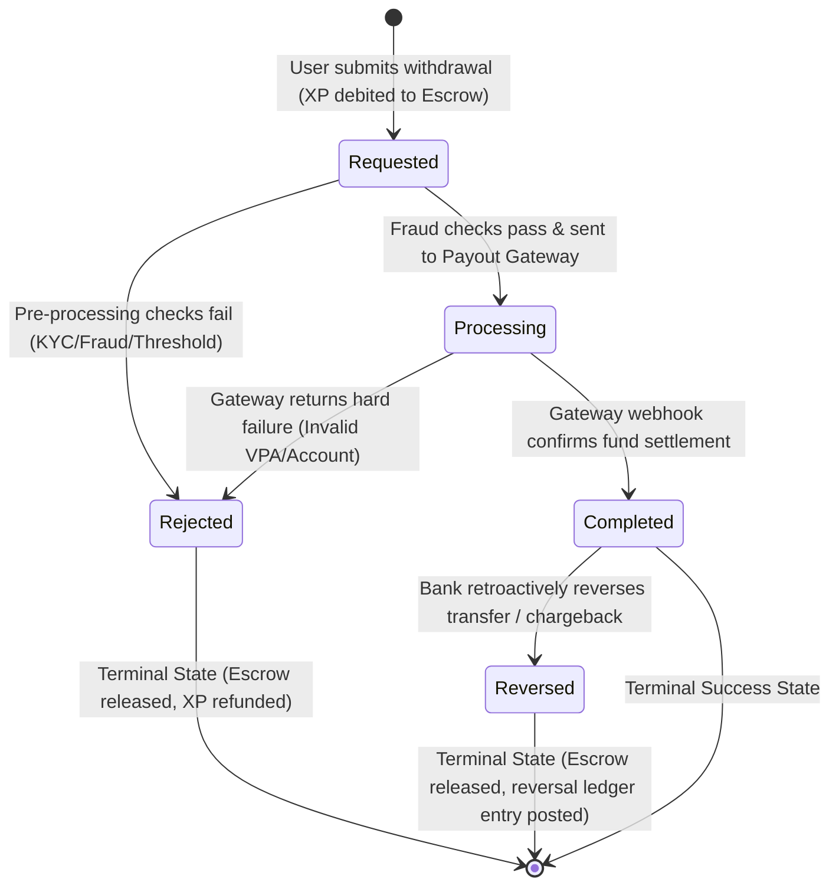

# VELOOP Rewards — Withdrawal Analytics Specification

> **PROPOSED SCHEMA — NOT YET IMPLEMENTED.**
> This spec AUGMENTS the existing `Withdrawals` table in
> `05_data_model/er_diagram.dbml`. The existing table captures basic
> withdrawal state; this spec adds lifecycle timestamps, reason
> categorization, and ledger linkage.

---

## 1. Entity: withdrawals (AUGMENTED)

The augmented `Withdrawals` entity bridges user-facing cash disbursement requests with external payment rails (UPI, IMPS, digital vouchers) and internal accounting ledgers. The updated schema introduces precise state-transition timestamps, categorical failure attribution, distributed correlation identifiers, and strict foreign-key linkage to `ledger_entries`.

### Schema Delta: Existing Columns vs. New Columns

| Column Name | Status | Type | Nullable | Reason / Description |
| :--- | :---: | :--- | :---: | :--- |
| **`withdrawal_id`** | Confirmed | String (PK) | No | Unique disbursement identifier (format `WDL_` + UUIDv4). |
| **`user_id`** | Confirmed | String (FK) | No | Foreign key linking to `Users.user_id`. |
| **`requested_datetime`** | Confirmed | Timestamp | No | Client submission timestamp when withdrawal was initiated. |
| **`amount_inr`** | Confirmed | Decimal(10,2) | No | Fiat disbursement cash value in Indian Rupees ($\ge ₹50.00$). |
| **`xp_deducted`** | Confirmed | Integer | No | Points debited from user wallet ($\ge 500$ XP). |
| **`payout_method`** | Confirmed | Varchar(30) | No | Payout rail: `UPI_VPA`, `IMPS_BANK`, `AMAZON_PAY_VOUCHER`, `FLIPKART_VOUCHER`. |
| **`payout_status`** | Confirmed | Varchar(30) | No | Macro operational state: `Requested`, `Processing`, `Completed`, `Rejected`, `Reversed`. |
| **`gateway_name`** | Confirmed | Varchar(50) | Yes | Payment aggregator processing payout (`CASHFREE`, `RAZORPAYX`, `PAYU`). |
| **`gateway_reference`** | Confirmed | Varchar(100) | Yes | External banking UTR or gateway payment ID. |
| **`failure_category`** | Confirmed | Varchar(50) | Yes | Standardized error code if rejected or failed. |
| **`failure_reason`** | Confirmed | Varchar(255) | Yes | Diagnostic error message returned by gateway or risk engine. |
| **`risk_score`** | Confirmed | Float | No | Anti-fraud score evaluated at submission (`0.00` to `1.00`). |
| **`payout_account_hash`** | Confirmed | Varchar(64) | No | SHA-256 hash of beneficiary account/VPA to avoid plain PII. |
| **`completed_at`** | Confirmed | Timestamp | Yes | Settlement confirmation timestamp received from banking rail. |
| **`processing_at`** | **Proposed (NEW)** | Timestamp | Yes | Exact timestamp when payout moved to `Processing` and was sent to banking rail. Enables granular queue vs. gateway latency measurement. |
| **`rejected_at`** | **Proposed (NEW)** | Timestamp | Yes | Exact timestamp when payout was marked `Rejected`. Enables rejection turnaround tracking. |
| **`reversed_at`** | **Proposed (NEW)** | Timestamp | Yes | Exact timestamp when bank retroactively reversed a completed transfer. |
| **`reason_category`** | **Proposed (NEW)** | Enum | Yes | Standardized root-cause category: `insufficient_balance`, `kyc_failed`, `payment_failure`, `user_cancelled`, `fraud_review`, `other`. |
| **`ledger_transaction_id`** | **Proposed (NEW)** | String (FK) | No | Foreign key referencing `ledger_entries.transaction_id`. Links disbursement atomically to double-entry ledger legs. |
| **`processing_owner`** | **Proposed (NEW)** | String | Yes | Service worker ID, automated batch runner, or compliance analyst handle processing the disbursement. |
| **`correlation_id`** | **Proposed (NEW)** | String | Yes | Distributed trace ID spanning client request, backend API, payout router, and gateway webhook. |
| **`method_details_hash`** | **Proposed (NEW)** | String | Yes | Salted SHA-256 hash of beneficiary details (VPA, IFSC+Account). Renamed from `payout_account_hash`. Prevents PII leaks while enabling repeat beneficiary fraud clustering. |

> [!NOTE]
> **Column rename: payout_account_hash → method_details_hash.**  
> Any existing code writing to the old name must be updated. The rename preserves semantic intent (hashed PII for the payout method), only the name changes.

> **Sensitivity Classification**:
> - All new columns (`processing_at`, `rejected_at`, `reversed_at`, `reason_category`, `ledger_transaction_id`, `processing_owner`, `correlation_id`, `method_details_hash`) are classified as **Internal**.
> - Financial balances in associated ledger tables remain **Restricted**.

---

## 2. Withdrawal Lifecycle State Machine

The payout lifecycle is governed by a deterministic finite-state machine with seven states (including initial and terminal pseudo-states) and five valid state transitions:



### State Machine Transition Rules & Accounting Effects

1. **`[*] --> Requested`**:
   - Trigger: User submits cash-out request in mobile app.
   - Action: Validates user eligibility; creates `Withdrawals` row in `Requested` status. Atomically writes ledger transaction debiting `user_wallet` and crediting `withdrawal_clearing`.
2. **`Requested --> Processing`**:
   - Trigger: Risk rules pass; payout payload dispatched via API to payment aggregator (Cashfree/RazorpayX).
   - Timestamp: Populates `processing_at = CURRENT_TIMESTAMP`.
3. **`Requested --> Rejected`**:
   - Trigger: Pre-processing failure (e.g., suspicious velocity, emulator detected, KYC incomplete).
   - Timestamp: Populates `rejected_at = CURRENT_TIMESTAMP`. Sets `reason_category` (e.g., `fraud_review`, `kyc_failed`).
   - Action: Writes offsetting ledger transaction debiting `withdrawal_clearing` and crediting `user_wallet` (XP refunded).
4. **`Processing --> Completed`**:
   - Trigger: Payment gateway sends signed cryptographic webhook confirming successful transfer to beneficiary.
   - Timestamp: Populates `completed_at = CURRENT_TIMESTAMP`.
   - Action: Finalizes withdrawal clearing leg.
5. **`Processing --> Rejected`**:
   - Trigger: Payout gateway webhook returns permanent rejection (e.g., `ACCOUNT_DOES_NOT_EXIST`, `VPA_NOT_FOUND`).
   - Timestamp: Populates `rejected_at = CURRENT_TIMESTAMP`. Sets `reason_category = 'payment_failure'`.
   - Action: Writes offsetting ledger transaction refunding XP to `user_wallet`.
6. **`Completed --> Reversed`**:
   - Trigger: Clearing house or partner bank initiates post-settlement return/chargeback.
   - Timestamp: Populates `reversed_at = CURRENT_TIMESTAMP`. Sets `reason_category = 'payment_failure'`.
   - Action: Emits reversal alert; writes reversal ledger transaction referencing `ledger_transaction_id`.

### Operational Invariants

- **INV-W1: Completion Integrity**:
  `completed_at IS NOT NULL` if and only if `payout_status = 'Completed'`. A withdrawal cannot have a completion timestamp without being in the terminal completed state.
- **INV-W2: Rejection Integrity**:
  `rejected_at IS NOT NULL` if and only if `payout_status = 'Rejected'`.
- **INV-W3: Chronological Monotonicity**:
  All lifecycle timestamps must be monotonically forward in time:
  $$\text{completed\_at} \ge \text{processing\_at} \ge \text{requested\_datetime}$$
- **INV-W4: Financial Conservation**:
  Every completed withdrawal must link to a valid double-entry transaction (`ledger_transaction_id`) that debits `user_wallet` and credits `withdrawal_clearing`.

---

## 3. KPI Unblock Queries

The augmented `Withdrawals` schema directly unblocks critical payout performance, SLA, and unit economic metrics. All queries are fully runnable against the augmented schema:

### K46 — Withdrawal Completion Rate
*Computes the percentage of submitted withdrawal requests that settle successfully into user destination accounts.*

```sql
-- K46: Withdrawal completion rate
SELECT 
    COUNT(CASE WHEN payout_status = 'Completed' THEN 1 END) AS completed_withdrawals,
    COUNT(*) AS total_withdrawal_requests,
    ROUND(
        COUNT(CASE WHEN payout_status = 'Completed' THEN 1 END) * 100.0 / NULLIF(COUNT(*), 0),
        2
    ) AS withdrawal_completion_rate_pct
FROM withdrawals;
```

### K47 — Withdrawal Processing Time (Median)
*Measures the 50th percentile elapsed time from initial user submission (`requested_datetime`) to terminal bank settlement (`completed_at`).*

```sql
-- K47: Withdrawal processing time (median)
SELECT 
    PERCENTILE_CONT(0.50) WITHIN GROUP (ORDER BY EXTRACT(EPOCH FROM (completed_at - requested_datetime))) AS median_processing_time_seconds,
    ROUND(
        PERCENTILE_CONT(0.50) WITHIN GROUP (ORDER BY EXTRACT(EPOCH FROM (completed_at - requested_datetime))) / 60.0, 
        2
    ) AS median_processing_time_minutes,
    ROUND(
        PERCENTILE_CONT(0.50) WITHIN GROUP (ORDER BY EXTRACT(EPOCH FROM (completed_at - requested_datetime))) / 3600.0, 
        2
    ) AS median_processing_time_hours
FROM withdrawals
WHERE payout_status = 'Completed'
  AND completed_at IS NOT NULL;
```

### P90 Withdrawal Processing Time
*Evaluates the 90th percentile tail latency to identify SLA breaches and operational bottlenecks.*

```sql
-- P90 Withdrawal Processing Time
SELECT 
    PERCENTILE_CONT(0.90) WITHIN GROUP (ORDER BY EXTRACT(EPOCH FROM (completed_at - requested_datetime))) AS p90_processing_time_seconds,
    ROUND(
        PERCENTILE_CONT(0.90) WITHIN GROUP (ORDER BY EXTRACT(EPOCH FROM (completed_at - requested_datetime))) / 60.0, 
        2
    ) AS p90_processing_time_minutes,
    ROUND(
        PERCENTILE_CONT(0.90) WITHIN GROUP (ORDER BY EXTRACT(EPOCH FROM (completed_at - requested_datetime))) / 3600.0, 
        2
    ) AS p90_processing_time_hours
FROM withdrawals
WHERE payout_status = 'Completed'
  AND completed_at IS NOT NULL;
```

### Withdrawal Rejection Rate & Reason Breakdown
*Measures the percentage of withdrawal requests rejected prior to or during gateway processing, categorized by root cause.*

```sql
-- Withdrawal Rejection Rate & Reason Breakdown
SELECT 
    COALESCE(reason_category, 'unspecified') AS reason_category,
    COUNT(*) AS rejected_count,
    ROUND(
        COUNT(*) * 100.0 / SUM(COUNT(*)) OVER (),
        2
    ) AS pct_of_rejections,
    ROUND(
        COUNT(*) * 100.0 / (SELECT COUNT(*) FROM withdrawals),
        2
    ) AS pct_of_total_requests
FROM withdrawals
WHERE payout_status = 'Rejected'
GROUP BY COALESCE(reason_category, 'unspecified')
ORDER BY rejected_count DESC;
```

### Withdrawal Reversal Rate
*Tracks the proportion of settled payouts that were subsequently reversed by banking rails.*

```sql
-- Withdrawal Reversal Rate
SELECT 
    COUNT(CASE WHEN payout_status = 'Reversed' THEN 1 END) AS reversed_count,
    COUNT(CASE WHEN payout_status IN ('Completed', 'Reversed') THEN 1 END) AS total_settled_or_reversed,
    ROUND(
        COUNT(CASE WHEN payout_status = 'Reversed' THEN 1 END) * 100.0 
        / NULLIF(COUNT(CASE WHEN payout_status IN ('Completed', 'Reversed') THEN 1 END), 0),
        4
    ) AS reversal_rate_pct,
    COALESCE(SUM(CASE WHEN payout_status = 'Reversed' THEN amount_inr ELSE 0 END), 0.0) AS total_reversed_inr
FROM withdrawals;
```

### Withdrawal Method Distribution
*Analyzes disbursement volume and ticket sizes across payout instruments (UPI, IMPS, vouchers).*

```sql
-- Withdrawal Method Distribution
SELECT 
    payout_method,
    COUNT(*) AS total_requests,
    COUNT(CASE WHEN payout_status = 'Completed' THEN 1 END) AS successful_payouts,
    ROUND(
        COUNT(CASE WHEN payout_status = 'Completed' THEN 1 END) * 100.0 / NULLIF(COUNT(*), 0),
        2
    ) AS method_success_rate_pct,
    SUM(amount_inr) AS total_volume_inr,
    ROUND(AVG(amount_inr), 2) AS avg_ticket_size_inr,
    ROUND(
        SUM(amount_inr) * 100.0 / SUM(SUM(amount_inr)) OVER (),
        2
    ) AS pct_of_total_volume
FROM withdrawals
GROUP BY payout_method
ORDER BY total_requests DESC;
```

---

## Data Authenticity Statement
This withdrawal analytics specification was prepared using simulated data created for analytical testing and product architecture modeling. No real financial ledgers, banking interfaces, payment gateway accounts, or monetary disbursements were accessed, analyzed, or included. All metrics, transaction models, and KPI formulas reflect simulated test environments.
