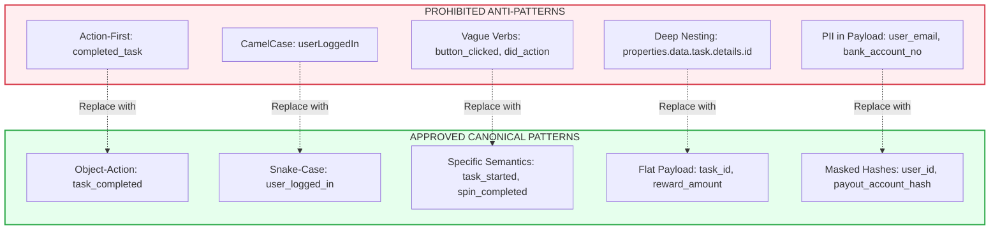

# VELOOP Rewards — Event Naming Standard & Taxonomy Specification

> **CRITICAL GOVERNANCE NOTICE**: All schemas, naming conventions, event taxonomies, and property definitions documented in this specification reflect **SIMULATED DATA** created for analytical testing and product architecture modeling. No real production telemetry or user PII was evaluated.

---

## 1. Scope & Objective

This specification establishes the official event naming conventions, semantic architecture, and taxonomy standards for VELOOP Rewards. It provides a single source of truth for:
- Enforcing the canonical `object_action` syntactic structure across all client and server telemetry pipelines.
- Standardizing the approved registry of reserved objects and reserved actions.
- Defining property casing rules, data type constraints, and payload architectural invariants.
- Establishing strict anti-pattern guidelines to prevent schema degradation and ambiguity.
- Categorizing all naming standards as `Confirmed`, `Proposed`, or `To Be Verified`.

---

## 2. Core Syntactic Architecture: `object_action`

All event names emitted within the VELOOP ecosystem must strictly follow the **`object_action`** naming syntax formatted in lower `snake_case`.

$$\text{Event Name} = \langle \text{reserved\_object} \rangle \_ \langle \text{reserved\_action} \rangle$$

*Example*: `task_completed`, `user_registered`, `withdrawal_requested`.

### 2.1 Rationale for `object_action`

1. **Lexicographical Grouping & Discovery**:
   - In data warehouse catalogs (BigQuery, Snowflake), BI dropdowns (Metabase, Looker), and stream monitors (Kafka, Segment), events automatically sort alphabetically by their business domain entity (`task_completed`, `task_failed`, `task_opened`, `task_started`, `task_viewed`).
   - Inverted syntax (`action_object` such as `completed_task`) scatters related entity telemetry across disparate alphabetical indexes.

2. **Semantic Clarity & Minimal Ambiguity**:
   - Establishes a predictable mental model: the **object** defines the *noun/entity* being acted upon, and the **action** defines the *state change or verb* that transpired.
   - Eliminates ambiguous abbreviations and informal verbs (e.g., replacing `task_done`, `finish_task`, `did_task` with the single standard `task_completed`).

3. **Multi-Platform Engineering Alignment**:
   - Enables front-end (Android, iOS, Web) and back-end (Auth, Ledger, Risk Services) teams to construct telemetry pipelines without negotiating ad-hoc string names.

---

## 3. Reserved Objects Registry

An event object represents the primary domain entity undergoing a lifecycle transition. Telemetry producers must only utilize objects from the approved registry below:

| Reserved Object | Entity Description | Primary Business Domain | Status |
| :--- | :--- | :--- | :---: |
| **`user`** | The persistent platform member and authentication entity | Identity & Account Lifecycle | Confirmed |
| **`session`** | The ephemeral visit container tracking dwell time and focus | Engagement & Clickstream | Confirmed |
| **`onboarding`** | The multi-step new user tutorial and introductory activation wizard | Product Activation | Proposed |
| **`task`** | Discrete earning micro-activities (ads, offers, surveys, app trials) | Earning Engine | Confirmed |
| **`reward`** | Financial XP / point value issuance, hold, or clawback | Economy & Rewards | Proposed |
| **`daily_reward`** | Calendar-based daily login incentive mechanic | Retention & Daily Habits | Confirmed |
| **`streak`** | Consecutive active day counter and milestone progression | Retention & Gamification | Confirmed |
| **`mission`** | Multi-task, multi-day achievement goals unlocking tier bonuses | Gamification & Levels | Confirmed |
| **`badge`** | Gamified status tokens awarded for behavioral milestones | Gamification & Recognition | Confirmed |
| **`spin`** | Lucky spin-the-wheel chance mechanic awarding random prizes | Gamification & Mini-Games | Confirmed |
| **`referral`** | Directional invitation graph linking referrer and referee | Growth & Viral Loops | Confirmed |
| **`wallet_transaction`** | Double-entry financial journal entry tracking credits, debits, holds | Financial Accounting | Proposed |
| **`withdrawal`** | Cash disbursement transaction processed via external banking rails | Financial Payouts | Proposed |

---

## 4. Reserved Actions Registry

An action represents the exact lifecycle transition, state mutation, or user interaction that occurred. Telemetry producers must select actions strictly from the approved registry:

| Reserved Action | Semantic Definition & Trigger Condition | Lifecycle Phase | Status |
| :--- | :--- | :--- | :---: |
| **`viewed`** | Surface, modal, card, or banner impression rendered on client screen | Impression / Discovery | Confirmed |
| **`opened`** | User intentionally expanded a collapsed card, tab, or modal window | Engagement / Intent | Confirmed |
| **`started`** | Execution initiated for a duration-based activity, task, or session | Execution / Active | Confirmed |
| **`completed`** | Successful finish of all client-side and business requirements | Execution / Success | Confirmed |
| **`failed`** | Terminal abort or error due to timeout, disconnect, or validation failure | Execution / Failure | Confirmed |
| **`credited`** | Permanent write of positive currency, points, or XP to the wallet ledger | Financial / Inflow | Proposed |
| **`pending`** | Temporary escrow hold placed awaiting asynchronous verification | Financial / Escrow | Proposed |
| **`reversed`** | Clawback or offsetting debit negating a previously posted credit | Financial / Outflow | Proposed |
| **`corrected`** | Rebalancing or arithmetic reconciliation entry adjusting a balance | Financial / Reconciliation | Proposed |
| **`requested`** | User submitted a formal request for cash-out or token redemption | Payout / Initiation | Proposed |
| **`processing`** | Request dispatched to external banking aggregator or payment rail | Payout / In-Flight | Proposed |
| **`rejected`** | Payout or conversion denied due to fraud, risk quarantine, or invalid VPA | Payout / Denial | Proposed |
| **`created`** | Generation of an entity (e.g., invite link generated, account profile created) | Inception / Setup | Confirmed |
| **`registered`** | Form submission and authentication credentials verified for new user | Inception / Account | Proposed |
| **`activated`** | New user cleared minimum activation hurdles (e.g., onboarding finished) | Activation / Habit | Proposed |
| **`converted`** | Commercial milestone achieved (referee earned $\ge 100$ XP, unlocking bounty) | Commercial Conversion | Proposed |
| **`updated`** | Entity metadata or profile configuration successfully modified | Mutation / Config | Proposed |
| **`claimed`** | User explicitly tapped "Claim" to collect a ready reward or bonus | Claim / Receipt | Confirmed |

---

## 5. Payload Properties Standards & Conventions

To maintain schema consistency and enable automated ingestion into modern analytics pipelines, all event payloads must adhere to these property standards:

### 5.1 Property Casing & Formatting
- **Casing**: All property keys must strictly use lower `snake_case` (e.g., `reward_amount`, `partner_id`, `payout_method`).
- **Forbidden Characters**: Spaces, hyphens, dots, and uppercase characters are strictly prohibited in property names.
- **Data Types**: All properties must declare an explicit primitive type: `String`, `Integer`, `Float`, `Boolean`, or `ISO-8601 Datetime`.

### 5.2 Mandatory Global Context Headers
Every event emitted by any client or server service must include the following global contextual properties:

| Header Property | Data Type | Requirement | Purpose | Validation |
| :--- | :--- | :---: | :--- | :--- |
| `event_id` | String | Mandatory | Unique atomic identifier for deduplication | Prefix `EVT_` + UUIDv4 |
| `user_id` | String | Mandatory | Permanent user entity identifier | Prefix `VLUSR` + 6 digits or UUIDv4 |
| `session_id` | String | Mandatory | Active visit container identifier | Prefix `SESS_` + 7 digits or UUIDv4 |
| `timestamp` | Datetime | Mandatory | Event occurrence timestamp | ISO-8601 UTC (`YYYY-MM-DDTHH:MM:SS.sssZ`) |
| `platform` | String | Mandatory | Client runtime environment | Controlled: `Android`, `iOS`, `Web`, `Server` |
| `app_version` | String | Mandatory | Client release build version | SemVer string (e.g., `1.4.2`) |

---

## 6. Prohibited Anti-Patterns

To preserve telemetry hygiene, the data platform automatically rejects payloads containing the following anti-patterns:

1. **`action_object` Syntax**: Naming events `completed_task`, `logged_in_user`, or `clicked_ad` is strictly prohibited. Use `task_completed`, `user_logged_in`, and `ad_started`.
2. **CamelCase and PascalCase**: Naming events `taskCompleted` or `UserRegistered` violates ingestion validation.
3. **Generic Clickstream Verbs**: Emitting generic UI events such as `button_clicked` or `screen_viewed` without entity semantics is prohibited. Telemetry must articulate business meaning (`daily_reward_claimed`, `wallet_viewed`).
4. **Deeply Nested JSON Payloads**: Payloads exceeding two levels of nesting (`payload.details.sub.val`) are flattened or rejected to avoid JSON parsing bottlenecks in columnar analytical warehouses.
5. **PII and Sensitive Financial Credentials**: Never emit plain email addresses, phone numbers, login credentials, UPI VPAs, or bank account numbers in event payloads. Use persistent entity identifiers (`user_id`) or cryptographic hashes (`payout_account_hash`).

---

## 7. Governance Classification: Confirmed vs. Proposed vs. To Be Verified

> [!IMPORTANT]
> **Explicit Implementation Classification Callouts**:
>
> 1. **Confirmed Elements (Implemented in Simulated Baseline)**:
>    - Core object set currently active in `02_Feature_Events`: `daily_reward`, `spin`, `mission`, `badge`, `streak`, `referral`.
>    - Primary actions currently active in telemetry: `viewed`, `opened`, `started`, `completed`, `claimed`, `earned`, `created`.
>    - Object-action syntax already dominant in 30 out of 35 events in `02_Feature_Events`.
>
> 2. **Proposed Elements (Required for Production Architecture)**:
>    - Unification of specialized task verbs (`ad_completed`, `tap_completed`, `mining_stopped`) into canonical `task_*` events with a `task_type` attribute.
>    - Formal financial transaction events: `wallet_transaction_created`, `wallet_transaction_completed`, `wallet_transaction_reversed`.
>    - Five-state cash disbursement events: `withdrawal_requested`, `withdrawal_processing`, `withdrawal_completed`, `withdrawal_rejected`, `withdrawal_reversed`.
>    - Four-state referral conversion events: `referral_created`, `referral_registered`, `referral_activated`, `referral_converted`.
>
> 3. **To Be Verified (Requires Engineering & Business Alignment)**:
>    - Maximum allowable payload byte size per event before client-side truncation (proposed as 8 KB).
>    - Event schema registry validation enforcement mode (strict reject vs. quarantine dead-letter queue).
>    - Legacy event migration window for transitioning deprecated event names (`ad_skipped`, `level_up`) to the canonical taxonomy.

---

## Data Authenticity Statement
This event naming standard specification was prepared using simulated data created for analytical testing and product architecture modeling. No real production telemetry systems, live event tracking platforms, or user interaction data were accessed, analyzed, or included. All naming standards and taxonomy classifications reflect simulated test environments.
