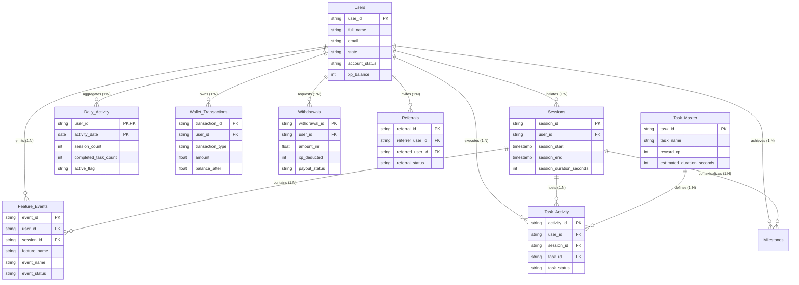

# VELOOP Rewards — Logical Data Model & Relationship Documentation

> **CRITICAL GOVERNANCE NOTICE**: All schemas, entity relationships, cardinalities, and relational mappings documented in this specification reflect **SIMULATED DATA** created for analytical testing and product architecture modeling. No real production database schemas, user PII, or financial records were evaluated.

---

## 1. Scope & Objective

This document provides the formal structural and semantic documentation for the VELOOP Rewards logical data model. It defines:
- Primary key constraints and entity identity models across all core and proposed tables.
- A comprehensive Foreign Key Map defining join paths, cardinalities, and referential integrity actions.
- In-depth architectural explanations of atomic event clickstream relationships and double-entry transaction ledgers.
- A detailed "Known Limitations" audit articulating which relationships cannot be verified in the supplied simulated data and why.
- Governance status classifications categorizing all structures as `Confirmed`, `Proposed`, or `To Be Verified`.

---

## 2. Entity Primary Key Registry

Every entity within the logical data model possesses an immutable primary key ensuring unique row-level addressability:

| Entity Name | Primary Key | Data Type | Key Format / Specification | Implementation Status | Business Definition |
| :--- | :--- | :--- | :--- | :---: | :--- |
| **`Users`** | `user_id` | `VARCHAR(16)` | Prefix `VLUSR` + 6 digits (`VLUSR000001` - `VLUSR001000`) | Confirmed | Master unique identifier for platform user account. |
| **`Sessions`** | `session_id` | `VARCHAR(16)` | Prefix `SESS` + 7 digits (`SESS0000001` - `SESS0007913`) | Confirmed | Unique visit container tracking user dwell and app focus. |
| **`Feature_Events`** | `event_id` | `VARCHAR(16)` | Prefix `EVT` + 8 digits (`EVT00000001` - `EVT00035704`) | Confirmed | Unique atomic telemetry clickstream record. |
| **`Daily_Activity`** | `(user_id, activity_date)` | `Composite` | Composite of `user_id` + Calendar Date (`YYYY-MM-DD`) | Confirmed | Aggregated user-day longitudinal activity partition. |
| **`Task_Activity`** | `activity_id` | `VARCHAR(16)` | Prefix `ACT` + 7 digits (`ACT0000001` - `ACT0009846`) | Confirmed | Unique micro-task execution attempt record. |
| **`Milestones`** | `milestone_id` | `INTEGER` | Monotonic auto-incrementing integer surrogate key | Confirmed | Gamified achievement milestone completion instance. |
| **`Feature_Usage`** | `feature_name` | `VARCHAR(50)` | Controlled list of 15 canonical feature surface strings | Confirmed | Summary analytics mart keyed by platform feature. |
| **`Task_Master`** | `task_id` | `VARCHAR(16)` | Prefix `TASK` + 4 digits (`TASK0001` - `TASK0080`) | Proposed | Master catalog defining metadata for the 80 task IDs. |
| **`Rewards`** | `reward_sku` | `VARCHAR(50)` | Alphanumeric SKU (e.g. `RWD_AMZN_050`) | Proposed | Master redemption catalog for vouchers and gift cards. |
| **`Wallet_Transactions`** | `transaction_id` | `VARCHAR(64)` | Format `TXN_` + UUIDv4 | Proposed | Immutable primary key for double-entry ledger journal entry. |
| **`Withdrawals`** | `withdrawal_id` | `VARCHAR(64)` | Format `WDL_` + UUIDv4 | Proposed | Unique cash disbursement payout transaction record. |
| **`Referrals`** | `referral_id` | `VARCHAR(64)` | Format `REF_` + UUIDv4 | Proposed | Unique viral relationship instance linking inviter to referee. |

---

## 3. Foreign Key Architecture & Referential Integrity Map

The relational graph is structured around the central `Users` entity, radiating outward into engagement containers, telemetry events, gamified achievements, and financial ledgers:

| Child Entity | Child Field (Foreign Key) | Parent Entity | Parent Field (Primary Key) | Cardinality | Join Nature | Cascade Action | Status |
| :--- | :--- | :--- | :--- | :---: | :--- | :--- | :---: |
| **`Sessions`** | `user_id` | `Users` | `user_id` | **1 : N** | Inner / Mandatory | `ON DELETE CASCADE` | Confirmed |
| **`Feature_Events`** | `user_id` | `Users` | `user_id` | **1 : N** | Inner / Mandatory | `ON DELETE CASCADE` | Confirmed |
| **`Feature_Events`** | `session_id` | `Sessions` | `session_id` | **1 : N** | Inner / Mandatory | `ON DELETE CASCADE` | Confirmed |
| **`Daily_Activity`** | `user_id` | `Users` | `user_id` | **1 : N** | Inner / Mandatory | `ON DELETE CASCADE` | Confirmed |
| **`Task_Activity`** | `user_id` | `Users` | `user_id` | **1 : N** | Inner / Mandatory | `ON DELETE CASCADE` | Confirmed |
| **`Task_Activity`** | `session_id` | `Sessions` | `session_id` | **1 : N** | Inner / Mandatory | `ON DELETE CASCADE` | Confirmed |
| **`Task_Activity`** | `task_id` | `Task_Master` | `task_id` | **1 : N** | Inner / Mandatory | `ON DELETE RESTRICT` | Proposed |
| **`Milestones`** | `user_id` | `Users` | `user_id` | **1 : N** | Inner / Mandatory | `ON DELETE CASCADE` | Confirmed |
| **`Milestones`** | `session_id` | `Sessions` | `session_id` | **1 : N** | Inner / Mandatory | `ON DELETE CASCADE` | Confirmed |
| **`Wallet_Transactions`** | `user_id` | `Users` | `user_id` | **1 : N** | Inner / Mandatory | `ON DELETE RESTRICT` | Proposed |
| **`Withdrawals`** | `user_id` | `Users` | `user_id` | **1 : N** | Inner / Mandatory | `ON DELETE RESTRICT` | Proposed |
| **`Referrals`** | `referrer_user_id` | `Users` | `user_id` | **1 : N** | Inner / Mandatory | `ON DELETE CASCADE` | Confirmed |
| **`Referrals`** | `referred_user_id` | `Users` | `user_id` | **1 : N** | Outer / Conditional | `ON DELETE SET NULL` | Confirmed |

---

## 4. In-Depth Relational Mechanics

### 4.1 Event Relationships & Clickstream Pathing
1. **Three-Tier Hierarchy (`Users` $\rightarrow$ `Sessions` $\rightarrow$ `Feature_Events`)**:
   - Every atomic interaction (`event_id`) is bounded within an explicit session visit (`session_id`), which belongs to a permanent account (`user_id`).
   - Referential integrity tests confirmed **0% orphan events**: every single event in `03_Feature_Events` successfully joins to a valid parent session in `02_Sessions` and user in `01_Users_1000`.
2. **Denormalized Attribution Headers**:
   - For analytical performance, `03_Feature_Events` carries denormalized client attributes (`device`, `platform`, `acquisition_source`). In analytical SQL queries, this eliminates the need to perform expensive 3-way joins to `01_Users_1000` when slicing event counts by marketing source.
3. **Session Visit Boundaries**:
   - An event's `event_datetime` must satisfy: `session_start <= event_datetime <= session_end`. Any event occurring outside these bounds indicates a client clock synchronization error or a zombie socket connection.

### 4.2 Financial Ledger & Transaction Flow
1. **Double-Entry Balance Derivation**:
   - In the proposed financial architecture, `Users.xp_balance` is a materialized view calculated strictly from the ledger:
     $$\text{xp\_balance} = \sum \text{amount}_{\text{CREDIT}} - \sum \text{amount}_{\text{DEBIT}} - \sum \text{amount}_{\text{HOLD}}$$
2. **Withdrawal Escrow Interlock**:
   - When a user submits a cash-out request (`withdrawal_requested`), two atomic entries are committed synchronously:
     1. A row is inserted into `Withdrawals` with `payout_status = 'Requested'`.
     2. A balancing row is posted to `Wallet_Transactions` with `transaction_type = 'HOLD'`, moving the requested points from `available_balance` into `escrow_balance`.
   - If the payout reaches `Completed`, the hold is marked `SETTLED`.
   - If the payout reaches `Rejected`, an offsetting `RELEASE` entry restores the points to the user's available balance.

### 4.3 Directional Viral Referral Network
1. **Self-Referencing Graph**:
   - The `Referrals` entity models a directional graph between two user entities:
     - `referrer_user_id`: Mandatory foreign key pointing to the inviting user.
     - `referred_user_id`: Conditional foreign key pointing to the newly registered referee (null while the invitation link remains unused).
2. **Referential Integrity Constraint**:
   - A database-level check constraint enforces `referrer_user_id != referred_user_id`, preventing self-referral loops.
3. **Qualification Gating**:
   - Bounties are never distributed upon account registration. A foreign key trigger monitors referee task completions in `Task_Activity`, transitioning `referral_status` to `'Converted'` only when cumulative verified earnings reach $\ge 100$ XP across $\ge 2$ active days.

---

## 5. Known Limitations & Verification Constraints

While the core simulated datasets demonstrate referential integrity across the 1,000 users, empirical data profiling highlighted six critical architectural limitations:

1. **Missing Task Master Parent Catalog**:
   - **Finding**: `05_Task_Activity` contains 9,846 records referencing 80 distinct `task_id` strings (`TASK0001` to `TASK0080`).
   - **Limitation**: No parent table `Task_Master` exists in either source workbook. Consequently, task metadata (task title, payout rate, estimated duration, advertiser ID) cannot be verified in the supplied data.
   - **Governance Status**: The relationship `Task_Activity.task_id > Task_Master.task_id` is **Proposed**.

2. **Absence of Transaction Ledger and Withdrawal Tables**:
   - **Finding**: Neither source workbook contains transactional tables for `Wallet_Transactions` or `Withdrawals`.
   - **Limitation**: The financial relationships `Users -> Wallet_Transactions` and `Users -> Withdrawals` cannot be verified against historical records; they exist solely as static snapshots (`xp_balance` on `Users_1000_Clean`) and summary flags (`wallet_activity` on `04_Daily_Activity`).
   - **Governance Status**: Both relationships are **Proposed**.

3. **Unilateral Inbound-Only Referral Tracking**:
   - **Finding**: Inbound attribution is captured via `Users.acquisition_source = 'Referral'` and `Users.referral_source_detail`, but no table records outbound share generation, invite links sent, or share channels.
   - **Limitation**: The full viral funnel (`Created -> Registered -> Activated -> Converted`) cannot be calculated; only the final referee signup count is observable.
   - **Governance Status**: The complete `Referrals` relational entity is **Proposed**.

4. **Event Sequence Ambiguity (`sequence_number`)**:
   - **Finding**: In `03_Feature_Events`, the `sequence_number` attribute exhibits duplicate ordinal values within the same `session_id`.
   - **Limitation**: Event pathing reconstruction cannot rely solely on `sequence_number` and must sort events by `(session_id, event_datetime, event_id)`.
   - **Governance Status**: Field is marked **To Be Verified**.

5. **Snapshot Baseline Calculation Inversion**:
   - **Finding**: The synthetic generator calculated `days_since_registration` using a static snapshot date that preceded registration for 8 users, producing negative values (`-0.8` to `-0.2`).
   - **Limitation**: Derived tenure calculations cannot be verified without applying boundary clamping (`GREATEST(0, days_since_registration)`).
   - **Governance Status**: Field is marked **To Be Verified**.

6. **Missing Rewards Dimension Catalog**:
   - **Finding**: Datasets record point accrual counts, but lack a physical `Rewards` catalog documenting redeemable SKUs, merchant partners (Amazon, Flipkart), and item stock.
   - **Limitation**: Point redemption velocity and merchant margin take-rates cannot be empirically computed.
   - **Governance Status**: The `Rewards` entity is **Proposed**.

---

## Data Authenticity Statement
This logical data model and relationship documentation was prepared using simulated data created for analytical testing and product architecture modeling. No real production database tables, banking rails, user credentials, or live financial transactions were accessed, analyzed, or included. All entity schemas, foreign key mappings, and relational cardinalities reflect simulated test environments.
