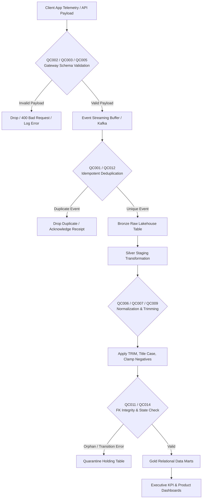

# VELOOP Rewards — Data Quality Control Framework

> **CRITICAL GOVERNANCE NOTICE**: All quality control rules, failure actions, and testing procedures documented in this framework reflect **SIMULATED DATA** created for pre-launch product analytics, telemetry architecture, and quality assurance modeling. No real production data or user PII was audited.

---

## 1. Quality Control Architecture Overview

The VELOOP Data Quality Control Framework establishes automated gates across the data lifecycle to identify, quarantine, and remediate data corruption before it reaches downstream analytics, financial reconciliation models, or executive dashboards.

Quality checks operate across six defined enforcement layers:
1. **Application (Client / App SDK)**: Real-time form validation, payload schema checks, and client-side sanitization.
2. **Collection (API Gateway / Event Ingest)**: Ingress token authentication, rate limiting, and event schema contract validation.
3. **Raw (Bronze / Lakehouse Ingestion)**: Append-only integrity checks, null rejection, and duplicate identification.
4. **Transformation (Silver / Data Modeling)**: String normalization, referential integrity joins, and enum mapping.
5. **Analytics (Gold / Data Marts)**: Aggregate consistency, metric sanity, and streak/funnel logic validation.
6. **Dashboard (Presentation / BI)**: Visual threshold alerts, anomaly monitors, and refresh heartbeat checks.

---

## 2. Master Quality Control Rules (QC001 – QC016)

| Rule ID | Rule Name & Description | Execution Layer | Validation Logic | Action on Failure | Owner |
| :---: | :--- | :--- | :--- | :--- | :--- |
| **QC001** | **Primary Key Entity Uniqueness** Guarantees primary identifiers (`user_id`, `session_id`, `event_id`) are globally unique. | **Raw / Database** | `COUNT(*) = COUNT(DISTINCT entity_id)` | Block transaction; quarantine duplicate record into dead-letter queue (DLQ); trigger P1 engineering alert. | Data Engineering |
| **QC002** | **Mandatory Primary Key Presence** Ensures entity identifiers are never null or empty strings. | **Application / Collection** | `entity_id IS NOT NULL AND TRIM(entity_id) != ''` | Reject payload at API gateway with `400 Bad Request`; log validation drop. | Backend Engineering |
| **QC003** | **ISO-8601 Timestamp Compliance** Ensures all event and lifecycle timestamps follow standardized UTC format. | **Collection / Ingest** | `TRY_PARSE(timestamp_col AS TIMESTAMP) IS NOT NULL` | Reject invalid format; require client to transmit timestamps formatted as `YYYY-MM-DDTHH:MM:SS.sssZ`. | Platform Engineering |
| **QC004** | **Calendar & Date Validity** Prevents impossible calendar dates (e.g. Month 14, Feb 30). | **Ingest / Raw** | Date components adhere to Gregorian calendar rules (`MM BETWEEN 1 AND 12`, `DD BETWEEN 1 AND 31`). | Route corrupted row to quarantine table; alert on ingestion pipeline error. | Data Engineering |
| **QC005** | **Categorical Status Enum Enforcement** Restricts status fields to approved canonical lists (`Active`, `Completed`, etc.). | **Application / Silver** | `status_field IN ('Active', 'Inactive', 'Suspended', 'Pending Verification')` | In API: Reject invalid enum. In Silver ETL: Map unknown status to `'Unknown_Pending_Review'`. | Analytics Engineering |
| **QC006** | **Canonical Casing Normalization** Prevents case-insensitive duplicate feature names and categories. | **Transformation** | `feature_name = PROPER_CASE(feature_name)` or match against Canonical Feature Dictionary. | Auto-correct casing via Silver staging lookup table (e.g. `'watch ads'` $\rightarrow$ `'Watch Ads'`). | Analytics Engineering |
| **QC007** | **Categorical Whitespace Sanitization** Eliminates leading and trailing whitespace from string attributes. | **Collection / Ingest** | `LENGTH(col) = LENGTH(TRIM(col))` | Automatically apply `TRIM()` on ingestion; log warning if discrepancy > 0. | Analytics Engineering |
| **QC008** | **Numeric Column Type Integrity** Ensures numeric metrics (`age`, `xp_balance`, `duration`) contain strictly numeric values. | **Raw / Staging** | `col IS NULL OR TRY_CAST(col AS NUMERIC) IS NOT NULL` | Reject string payloads during ingest; in staging, flag records for manual schema review. | Data Engineering |
| **QC009** | **Non-Negative Value Safeguard** Restricts currency balances, durations, and counts to non-negative numbers. | **Transformation / Marts** | `numeric_col >= 0` | Clamp negative derived fields (`GREATEST(0, val)`); alert finance engineering on balance violations. | Analytics Engineering |
| **QC010** | **Required Demographic Field Completeness** Guarantees mandatory profile attributes are populated. | **Application / Ingest** | `required_col IS NOT NULL AND TRIM(required_col) != ''` | Block user profile completion until mandatory fields (e.g. `city`, `acquisition_source`) are provided. | Product Engineering |
| **QC011** | **Referential Integrity & Foreign Key Match** Ensures child events, sessions, and tasks link to valid parent users. | **Transformation** | `FOREIGN KEY (user_id) REFERENCES users(user_id)` | Route orphan records to unassigned orphan holding table; reprocess upon user record arrival. | Analytics Engineering |
| **QC012** | **Event Stream Idempotency & Deduplication** Prevents network retry double-counting of behavioral events. | **Collection / Ingest** | Sliding window deduplication on `(user_id, session_id, sequence_number, event_name)`. | Drop duplicate event silently; return `200 OK` to client to acknowledge successful receipt. | Platform Engineering |
| **QC013** | **Event Taxonomy & Naming Governance** Restricts tracked events to pre-approved `object_action` taxonomy standard. | **Collection / CI/CD** | `event_name` matches regex `^[a-z]+(_[a-z]+)*$` and exists in Tracking Plan. | Block PR in CI/CD pipeline if unapproved events are introduced into codebase. | Data Governance |
| **QC014** | **Monotonic Temporal State Transitions** Ensures timestamps follow logical sequence (Completed $\ge$ Started $\ge$ Viewed). | **Transformation** | `completed_at >= started_at AND started_at >= viewed_at` | Flag record with `state_transition_error = TRUE`; exclude from task duration calculations. | Analytics Engineering |
| **QC015** | **Domain Completeness & Missing Table Safeguards** Enforces the existence of mandatory transactional ledgers. | **Architecture / Schema** | Schema validator checks presence of `wallet_transactions`, `withdrawals`, `referral_invites`. | Halt analytics pipeline build if core financial tables fail schema presence check. | Data Architect |
| **QC016** | **Snapshot Horizon & Observation Cutoff Alignment** Prevents activity timestamps from exceeding documented observation cutoffs. | **Transformation / Gold** | `timestamp_col <= snapshot_cutoff_timestamp` | Filter out-of-boundary records into future observation partition. | Data Analyst |

---

## 3. Severity Classification & Escalation Matrix

- **Critical Severity**:
  - *Definition*: Directly corrupts financial balances, causes double-counting in executive KPIs, or breaks core relational integrity.
  - *SLA*: Immediate automated quarantine; P1 engineering alert; fix required within 4 hours.
  - *Examples*: Duplicate `user_id`s, duplicate `event_id`s, missing `wallet_transactions` ledger, null `registration_datetime`.
- **High Severity**:
  - *Definition*: Prevents accurate segmentation or causes missing records in operational funnels.
  - *SLA*: Automated routing to review queue; remediation within 24 hours.
  - *Examples*: Malformed dates, unexpected nulls in required demographic attributes, missing task dimension master.
- **Medium Severity**:
  - *Definition*: Cosmetic inconsistencies, whitespace, or derived metric clamping issues that can be auto-remediated in staging.
  - *SLA*: Resolved automatically during ETL/ELT cleaning phase; review within standard sprint cycle.
  - *Examples*: Trailing whitespace, lowercase feature names, negative `days_since_registration`.
- **Low Severity**:
  - *Definition*: Documentation discrepancies or schema naming inconsistencies across legacy environments.
  - *SLA*: Backlog tracking; resolve during planned schema deprecation cycles.
  - *Examples*: Column name discrepancy (`verification_status` vs `email_verification_status`).

---

## 4. Remediation Workflow & Pipeline Integration

---

## Data Authenticity Statement
This Data Quality Control Framework was prepared using simulated data created for analytical testing and product architecture modeling. No real production data or user PII was accessed, analyzed, or included. All metrics, user counts, and behavioral distributions reflect simulated test environments.
