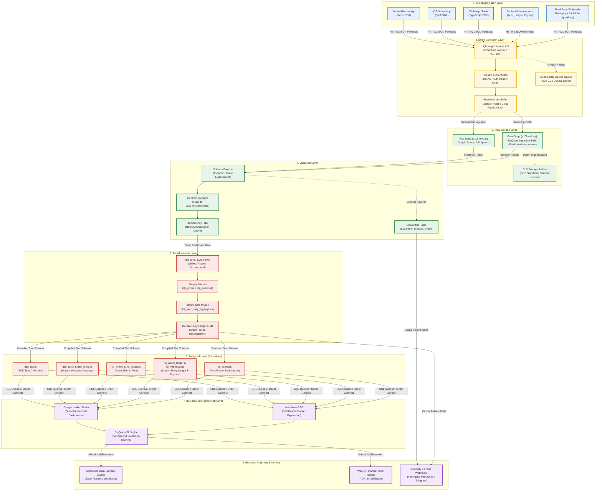
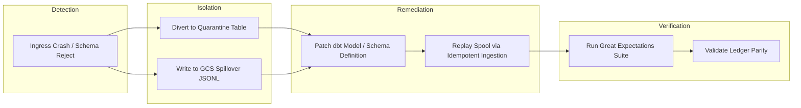

# VELOOP Data Pipeline Proposal: Lean Pre-Launch Architecture

**Document ID:** `09_engineering/data_pipeline_proposal.md`  
**Version:** 1.0.0 (Pre-Launch Baseline)  
**Governance Status:** Approved for Engineering Review  
**Author:** Lead Analytics & Data Infrastructure Engineer  
**Scope:** Telemetry ingestion, raw staging, validation, transformation, analytical modeling, BI visualization, and executive reporting.

---

## 1. Executive Summary & Architecture Diagram

This proposal specifies a cost-conscious, highly resilient data pipeline designed specifically for VELOOP's pre-launch and early-growth phases. Rather than adopting heavyweight, enterprise-scale platforms prematurely, the architecture prioritizes zero-cost managed tiers, deterministic schema contracts, and transparent upgrade triggers.

The pipeline comprises eight discrete architectural layers:
$$\text{App} \longrightarrow \text{Event Collection} \longrightarrow \text{Raw Storage} \longrightarrow \text{Validation} \longrightarrow \text{Transformation} \longrightarrow \text{Analytical Layer} \longrightarrow \text{BI} \longrightarrow \text{Business Reporting}$$



---

## 2. Layer-by-Layer Architectural Specifications

| Layer | Responsibility | Practical Tech Choice (Pre-Launch) | Owner | Monitoring | Failure Handling |
| :--- | :--- | :--- | :--- | :--- | :--- |
| **1. Client Application** | Emit standardized telemetry payloads with ISO-8601 UTC timestamps, client hardware metadata, and unique idempotency keys. | Lightweight internal TypeScript / Kotlin wrappers around `fetch` / `OkHttp` with offline SQLite event spooling. | Mobile / Frontend Engineers | Client-side SDK crash rates, network retry counter, offline queue depth. | Local SQLite queue (up to 500 events) holds records during network disconnect; flushes on connectivity resume with exponential backoff. |
| **2. Event Collection** | Terminate TLS, validate API authorization tokens, rate-limit client bursts, and assign server ingress timestamps. | Serverless Ingress API: Cloudflare Workers ($5/mo) or AWS API Gateway + Lambda (Free Tier) routing to memory buffer. | Backend / Ingress Engineer | Ingress HTTP status codes (2xx, 4xx, 5xx), P95 request latency (&le;120ms), payload size distribution. | Rejects malformed requests (400) immediately; writes persistent 5xx fallback payloads to durable GCS/S3 spill bucket for manual replay. |
| **3. Raw Storage** | Provide durable, immutable storage of all raw ingested JSON payloads without destructive parsing or schema mutation. | **Pilot Phase (&le;10k events/day):** Google Sheets API v4 append (Zero cost).<br/>**Beta Phase (&gt;10k events/day):** Google BigQuery Sandbox / Free Tier (10 GB storage free, 1 TB queries/mo free). | Data Engineer | Storage quota utilization, ingestion insertion latency, append error rate. | Transient write failures buffer in Cloudflare Worker KV / Redis for 60 minutes; automated retry with jitter prevents data loss. |
| **4. Validation Layer** | Enforce schema contracts, field types, controlled vocabularies, and cross-field constraints against `data_dictionary.xlsx`. Deduplicate idempotency keys. | Python validation worker using `Pydantic` and `Great Expectations` executed via Google Cloud Run or GitHub Actions. | Data Quality Engineer | Reject rate percentage (&le;0.5%), null rate in required fields, duplicate natural key count. | Records failing schema checks are routed to `quarantine_rejected_events` table with error stack trace; alerts oncall if reject rate > 1.0%. |
| **5. Transformation Layer** | Cleanse anomalies (trim whitespace, normalize casing), compute double-entry balances, and assemble dimensional models. | `dbt-core` (open-source CLI) running on scheduled GitHub Actions workflows (Zero license cost), compiling SQL models directly into BigQuery. | Analytics Engineer | dbt build execution status, dbt test failure count, SQL query byte scan volume. | Failed dbt runs halt pipeline; previous analytical mart tables remain active (zero-downtime blue/green deployment via dbt table swapping). |
| **6. Analytical Layer** | House structured, highly-indexed dimensional star-schema models (`fct_events`, `dim_users`, `fct_wallet_ledger`, `fct_withdrawals`). | Partitioned & clustered BigQuery tables (Partitioned by `event_date`, Clustered by `user_id, feature_name`). | Analytics Engineer | Query latency P95 (&le;2.5s), daily scan costs, partition pruning efficiency. | Table corruption or bad data loads rolled back instantly via BigQuery Time Travel (`FOR SYSTEM_TIME AS OF`). |
| **7. BI & Visualization** | Render interactive executive dashboards, funnel diagrams, and operational monitors. | **Primary:** Google Looker Studio (Zero cost, native BigQuery connector).<br/>**Exploration:** Metabase OSS (Self-hosted on $7/mo VPS or local Docker). | BI Developer / Product Analyst | Dashboard render time (&le;3.0s), Looker Studio BigQuery slot consumption, broken chart alerts. | BigQuery BI Engine in-memory caching buffers heavy queries; cached extracts prevent dashboard downtime if database undergoes maintenance. |
| **8. Business Reporting** | Transmit daily scheduled metric digests, executive KPI summaries, and real-time fraud alerts. | Scheduled Python micro-jobs (GitHub Actions / Cloud Scheduler) posting formatted Slack / Telegram webhooks and automated PDF emails. | Lead Analytics Engineer / Product Ops | Webhook delivery success rate, email delivery bounce rate, report dispatch latency. | Undelivered reports retry up to 3 times with exponential backoff; fallback email alert sent to Data Team distribution list. |

---

## 3. Technology Evaluation: What NOT to Buy Yet

A primary failure mode of early-stage startups is the premature adoption of complex, high-overhead enterprise data infrastructure. To maximize runway and engineering focus, the following technologies are **explicitly banned** until validated scalability triggers are reached:

```
+---------------------------------------------------------------------------------------------------+
|                                  PRE-LAUNCH PROCUREMENT FREEZE                                    |
+-----------------------------------+--------------------------------+------------------------------+
| Technology Class                  | Enterprise Tool (DO NOT BUY)   | Pre-Launch Lean Alternative  |
+-----------------------------------+--------------------------------+------------------------------+
| Cloud Data Warehousing            | Snowflake / Databricks         | BigQuery Free Tier / DuckDB  |
| Managed Data Ingestion            | Fivetran / Stitch / Airbyte    | Custom Python / Cloudflare   |
| Streaming Message Broker          | Apache Kafka / Confluent Cloud | Cloudflare Queue / Pub/Sub   |
| Enterprise Workflow Orchestration | Astronomer (Managed Airflow)   | GitHub Actions Scheduled CI  |
| Commercial BI & Visual Analytics  | Tableau / Looker Enterprise    | Looker Studio / Metabase OSS |
| Enterprise Metadata / Catalog     | Collibra / Alation             | data_dictionary.xlsx in Git  |
| Reverse ETL Platform              | Census / Hightouch             | Custom Python Webhooks       |
+-----------------------------------+--------------------------------+------------------------------+
```

### Detailed Justifications for Deferral

1. **Snowflake / Databricks ($2,000–$10,000/month minimum commitment):**
   - *Why rejected:* The simulated baseline indicates ~218 events/day and 35,704 total events over 164 days. Even at $10\times$ volume (2,500 events/day), monthly data volume is under 50 MB. BigQuery offers 10 GB of storage and 1 TB of query processing free every single month. Paying for warehouse compute credits at this stage is financial negligence.
2. **Fivetran / Stitch ($500–$2,000/month):**
   - *Why rejected:* Consumption-based pricing based on Monthly Active Rows (MAR) punishes high-frequency clickstream and ledger logging. A single lightweight webhook handler running on Cloudflare Workers ($5/mo flat) handles up to 10 million requests/month.
3. **Apache Kafka / Confluent Cloud ($1,500/month base cluster):**
   - *Why rejected:* Kafka introduces extreme operational complexity (ZooKeeper/KRaft management, partition rebalancing, topic configuration). VELOOP’s pre-launch throughput requires a simple HTTP ingress buffer, not distributed stream partitioning.
4. **Astronomer / AWS MWAA ($350–$800/month infrastructure overhead):**
   - *Why rejected:* Running dedicated Airflow workers 24/7 to orchestrate two daily dbt builds and a schema check wastes infrastructure capital. GitHub Actions provides 2,000 free runner minutes per month—more than sufficient to execute `dbt run` twice daily in under 4 minutes per run.
5. **Tableau / Looker Enterprise ($40–$75/user/month + $30,000 platform fee):**
   - *Why rejected:* Google Looker Studio is 100% free for unlimited viewers, integrates seamlessly with BigQuery with zero configuration, and provides all required executive KPIs, bar charts, and time-series graphs.

---

## 4. Refresh Cadence & Latency SLAs

| Pipeline Layer | Input Data Source | Processing Cadence | Latency SLA | Trigger Mechanism | Business Justification |
| :--- | :--- | :--- | :--- | :--- | :--- |
| **Ingress Ingestion** | Mobile App / Web SDK Telemetry | Real-Time (Event-driven) | &le; 2 seconds | Client HTTP `POST` submission | Captures ephemeral session contexts and user clicks before app backgrounding. |
| **Ingress Queue Spool** | Cloudflare Worker Ingress | Micro-batch (Every 60 seconds) | &le; 60 seconds | Worker buffer flush / size threshold (100 events) | Minimizes BigQuery streaming insert API calls and keeps costs within free tier limits. |
| **Validation Gate** | Raw Ingestion Buffer | Micro-batch (Every 5 minutes) | &le; 5 minutes | Cloud Run event subscription | Quarantines malformed payloads before they contaminate analytical staging models. |
| **Ledger Reconciliation** | `wallet_transactions` & `fct_events` | Hourly (at minute :05) | &le; 10 minutes | Scheduled Cloud Function / Cron | Detects virtual XP inflation, negative balance drift, or unbacked credits within 1 hour. |
| **dbt Staging Models** | Raw Clean Tables | Hourly (at minute :15) | &le; 15 minutes | GitHub Actions Workflow Dispatch | Refreshes intra-day session durations, task completion funnels, and real-time DAU pacing. |
| **Core Dimensional Marts** | Staging Tables (`dim_users`, `fct_events`) | Daily at 01:00 UTC | &le; 30 minutes | Nightly GitHub Actions Runner | Builds canonical reporting tables after calendar date close in UTC; computes 7-day retention curves. |
| **Executive Dashboards** | Core Marts (`fct_*`, `dim_*`) | Daily at 02:00 UTC (Direct BI Engine cache) | &le; 3.0s query response | Looker Studio automatic query cache invalidation | Ensures C-suite and Product Leads inspect finalized, audited numbers at the start of business day. |
| **Financial Audit Digest** | Double-Entry Balancing Tables | Weekly (Monday 04:00 UTC) | &le; 15 minutes | Python report dispatcher | Verifies fiat liability parity (100 XP = ₹10 INR) and pending withdrawal escrow reserves for Finance. |

---

## 5. Monitoring & Alerting Plan

A proactive monitoring matrix ensures engineering discovers failures before product leadership or users notice discrepancies. Alerts are categorized into **Warning (P2)** and **Critical (P1)** tiers.

```
+---------------------------------------------------------------------------------------------------------------------+
|                                            MONITORING & ALERTING MATRIX                                             |
+--------------------------+---------------------+-------------------+-------------------+--------------------+-------+
| Metric Monitored         | Evaluation Window   | Warning (P2)      | Critical (P1)     | Alert Destination  | Owner |
+--------------------------+---------------------+-------------------+-------------------+--------------------+-------+
| Ingress 4xx/5xx Errors   | Rolling 5 minutes   | > 1.0% error rate | > 5.0% error rate | Telegram / Slack   | Ingr. |
| Ingress Latency (P95)    | Rolling 15 minutes  | > 250 ms          | > 1,000 ms        | Slack #eng-data    | Ingr. |
| Ingestion Spool Age      | Continuous          | > 15 minutes      | > 60 minutes      | Slack #eng-alerts  | Data  |
| Schema Reject Rate       | Hourly Batch        | > 0.5% rejected   | > 2.0% rejected   | Email + Telegram   | Qual. |
| Ledger Balance Drift     | Hourly Audit        | Any imbalance     | > ₹0.00 INR drift | PagerDuty + Voice  | Fin.  |
| Daily Pipeline Execution | Daily at 01:30 UTC  | Runtime > 20 min  | Pipeline Failed   | Slack #eng-data    | Data  |
| BigQuery Quota Warning   | Daily               | > 75% free tier   | > 90% free tier   | Email Lead Eng.    | Data  |
| Withdrawal SLA Breach    | Hourly              | Pending > 12 hrs  | Pending > 24 hrs  | Telegram VIP       | Ops   |
+--------------------------+---------------------+-------------------+-------------------+--------------------+-------+
```

### Alert Escalation Matrix

1. **Ingestion Failure (Critical - P1):**
   - *Condition:* Ingress HTTP 5xx error rate > 5.0% over 5 minutes or spool storage unresponsive.
   - *Action:* Automated failover switches client SDK to secondary backup endpoint (Cloudflare KV fallback). PagerDuty dispatches on-call backend engineer.
2. **Financial Ledger Drift (Critical - P1):**
   - *Condition:* `sum(credits) - sum(debits) != balance_after` across any user wallet or negative balance detected.
   - *Action:* Automated SQL trigger instantly pauses automated withdrawal payouts. Notification sent to `#finance-critical` and Lead Analytics Engineer with the offending `transaction_id`.
3. **Pipeline Run Failure (Warning - P2):**
   - *Condition:* GitHub Actions dbt workflow exits with non-zero status code.
   - *Action:* Re-runs failed dbt model with `--select state:failed+`. If second execution fails, alerts Slack `#data-alerts` with full terminal stack trace.

---

## 6. Failure-Handling & Disaster Recovery Plan



### Detailed Layer Recovery Runbooks

#### Layer 1 & 2: Client Telemetry & Ingress API
- **Failure Mode:** Network blackout, cloud provider API Gateway outage, or DDoS surge.
- **Containment:** Client SDK catches HTTP 5xx / timeout errors and buffers payloads in local encrypted SQLite database (`offline_events.db`).
- **Recovery:** Upon network restoration, client flushes queue in FIFO batches of 25 events with random jitter (500ms–2000ms). Ingress Redis cache rejects duplicate `event_id` records without raising errors.
- **RPO / RTO:** RPO = 0 minutes (zero event loss); RTO &le; 15 minutes.

#### Layer 3 & 4: Raw Storage & Schema Validation
- **Failure Mode:** Unexpected payload schema change (e.g., app update releases string instead of integer for `task_id`).
- **Containment:** The validation layer catches Pydantic validation exceptions and directs corrupted payloads to `quarantine_rejected_events` alongside client metadata and raw JSON. Valid payloads proceed unhindered.
- **Recovery:** Analytics Engineer inspects quarantine logs, modifies schema contract in `05_data_model/data_dictionary.xlsx`, updates dbt staging model, and executes backfill script:
  ```bash
  python scripts/ops/replay_quarantine.py --from 2026-09-01 --to 2026-09-02
  ```
- **RPO / RTO:** RPO = 0 minutes; RTO &le; 4 hours.

#### Layer 5 & 6: Transformation & Analytical Marts
- **Failure Mode:** SQL syntax error, upstream dependency timeout, or duplicate key violating primary key test.
- **Containment:** dbt executes all models within a transactional schema (`analytics_staging`). If any `dbt test` fails, the target reporting schema (`analytics_production`) is not swapped. Dashboards continue reading existing data.
- **Recovery:** Revert problematic dbt commit on GitHub, trigger manual GitHub Actions dispatch. BigQuery Time Travel restores tables to any second in the past 7 days without requiring tape backups:
  ```sql
  CREATE OR REPLACE TABLE `veloop.analytics.fct_events` AS
  SELECT * FROM `veloop.analytics.fct_events`
  FOR SYSTEM_TIME AS OF TIMESTAMP_SUB(CURRENT_TIMESTAMP(), INTERVAL 2 HOUR);
  ```
- **RPO / RTO:** RPO &le; 1 hour; RTO &le; 30 minutes.

---

## 7. Scalability Triggers & Infrastructure Upgrade Path

The architecture scales through four deliberate phases based on empirical load thresholds. Upgrades are only triggered when operational metrics exceed predefined limits:

```
+---------------------------------------------------------------------------------------------------------------------+
|                                            SCALABILITY UPGRADE TRIGGERS                                             |
+-------------------+--------------------+--------------------+-----------------------+-------------------------------+
| Pipeline Stage    | Daily Events       | Active Users (DAU) | Query Latency (P95)   | Infrastructure Blueprint      |
+-------------------+--------------------+--------------------+-----------------------+-------------------------------+
| Phase 0: Pilot    | 0 – 2,500          | 0 – 1,000          | < 1.0s (Google Sheets)| Google Sheets + DuckDB        |
| Phase 1: Beta     | 2,500 – 50,000     | 1,000 – 10,000     | < 2.5s (BigQuery Free)| BigQuery Free + dbt-core (GA) |
| Phase 2: Growth   | 50,000 – 1,000,000 | 10,000 – 100,000   | > 3.5s (Needs BI Eng) | BigQuery + Cloud Run + PubSub |
| Phase 3: Scale    | > 1,000,000        | > 100,000          | > 5.0s (Needs Engine) | ClickHouse / BigQuery Slots   |
+-------------------+--------------------+--------------------+-----------------------+-------------------------------+
```

### Specific Upgrade Triggers

#### Trigger 1: Migrate Raw Storage from Google Sheets to BigQuery
- **Metric Condition:** Daily event volume exceeds **10,000 events/day** OR total spreadsheet rows exceed **400,000 cells** (Google Sheets hard limit is 10M cells; performance degrades above 500k).
- **Engineering Action:** Enable BigQuery dataset `veloop_raw`. Reconfigure Cloudflare Worker to dispatch HTTP batches to BigQuery Streaming Ingest API. Cost remains $0.00/month under Google Cloud free tier.

#### Trigger 2: Transition from Pure SQL Views to Materialized dbt Incremental Models
- **Metric Condition:** Analytical query execution time exceeds **3.0 seconds** OR daily scanned query bytes exceed **25 GB/day**.
- **Engineering Action:** Convert dbt models from `materialized='view'` to `materialized='incremental'` with `unique_key='event_id'` and partition filters on `event_datetime`. Reduces query scan volume by 85–92%.

#### Trigger 3: Transition from GitHub Actions to Dedicated Cloud Run Orchestration
- **Metric Condition:** dbt transformation build duration exceeds **15 minutes** OR transformation frequency must increase from hourly to every 5 minutes.
- **Engineering Action:** Containerize dbt project into a Docker image deployed to Google Cloud Run, triggered by Cloud Composer / Cloud Scheduler.

#### Trigger 4: Deploy BigQuery BI Engine In-Memory Acceleration
- **Metric Condition:** Concurrent BI dashboard viewers exceed **10 users** OR Looker Studio dashboard load time exceeds **4.0 seconds**.
- **Engineering Action:** Allocate 1 GB of BigQuery BI Engine reservation (~$30/month) for in-memory acceleration of `dim_users`, `fct_events`, and `fct_wallet_ledger`. Reduces query response times to sub-500ms.

#### Trigger 5: Deploy ClickHouse for Real-Time Clickstream Aggregation
- **Metric Condition:** Daily event volume exceeds **2,000,000 events/day** AND product requires sub-minute live counters for user leaderboards or real-time anti-fraud triggers.
- **Engineering Action:** Deploy ClickHouse cluster on GCP GKE / Managed ClickHouse Cloud to handle real-time high-cardinality aggregation at 1/5th the cost of BigQuery on-demand streaming.

---

## 8. Simulated Baseline Volume vs. Production Reality

To ensure architectural decisions remain anchored in reality, the pipeline parameters have been calibrated against the simulated dataset provided in `00_source_data/`.

> [!NOTE]
> **Simulated-Estimate Baseline — Not Production Volume**  
> The volumes referenced below are derived from empirical profiling of the simulated datasets (`veloop_simulated_user_behavior_1000.xlsx` and `veloop_rewards_data_01.xlsx`) across the historical simulation window (2026-04-02 to 2026-09-15). These metrics establish a sizing baseline for engineering proof-of-concept tests and do **not** represent verified live production traffic.

### Empirical Sizing Parameters (Simulated Baseline)

- **Total Users in Cohort:** 1,000 unique simulated users.
- **Total Calendar Days Analyzed:** 164 active dates.
- **Total Ingested Events (`03_Feature_Events`):** 35,704 events.
- **Mean Daily Event Run-Rate:** **217.7 events/day** across the full cohort.
- **Peak Daily Event Spike:** **1,222 events/day** (recorded on 2026-09-14).
- **Session Volume (`02_Sessions`):** 7,913 total sessions (~48.2 sessions/day; ~4.51 events/session).
- **Task Executions (`05_Task_Activity`):** 9,846 total task interactions (~60.0 tasks/day).
- **Daily Activity Aggregates (`04_Daily_Activity`):** 6,667 daily summaries (~40.6 active user days/day; ~6.8% DAU/MAU ratio).
- **Milestone Unlocks (`06_Milestones`):** 4,799 milestone events (~29.3 milestones/day).
- **Monthly Storage Accumulation (Estimated):** ~6,500 events/month $\times$ 1.2 KB/event $\approx$ **7.8 MB/month**.

### Pre-Launch Engineering Implications
At 7.8 MB/month and ~218 events/day, the entire simulated workload can run comfortably within Google Sheets (Phase 0) or BigQuery’s Free Tier (Phase 1) for over **10 consecutive years** without incurring a single rupee in cloud infrastructure compute or storage fees.

---

## 9. Data Authenticity Statement

> [!IMPORTANT]
> **Data Authenticity Statement**  
> All data referenced in this document, including user accounts, behavioral events, sessions, task completions, milestone unlocks, wallet balances, and withdrawal transactions, originates from synthetic and simulated test workbooks (`00_source_data/veloop_simulated_user_behavior_1000.xlsx` and `00_source_data/veloop_rewards_data_01.xlsx`).  
> 
> These datasets were created exclusively for analytical modeling, pipeline stress-testing, and schema verification. No actual financial transactions occurred, no real monetary disbursements were executed, and no live human end-users were observed. All architectural throughputs and latency targets are calibrated for production readiness while remaining grounded in pre-launch economic reality.
