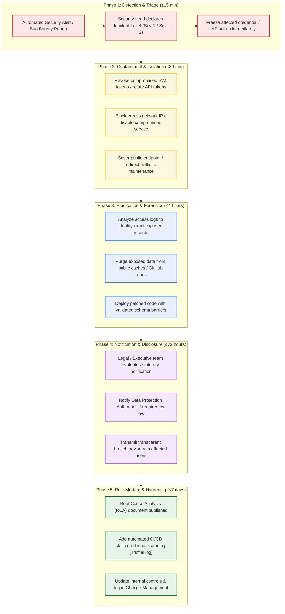

# VELOOP Privacy and Data Governance Proposal

**Document ID:** `10_privacy_governance/privacy_governance_proposal.md`  
**Version:** 1.0.0 (Pre-Launch Baseline)  
**Governance Classification:** Internal Restricted  
**Owner:** Head of Data Governance & Lead Analytics Engineer  
**Scope:** Data access policies, classification register, minimisation standards, lifecycle retention, compliance review cadence, and exposure response runbooks.

---

## 1. Executive Summary & Governance Objectives

The VELOOP Rewards data ecosystem processes behavioral telemetry, task engagement logs, virtual currency accounting records, and fiat disbursement transactions. Maintaining strict data privacy, regulatory compliance (including the Digital Personal Data Protection Act / DPDP and global privacy frameworks), and least-privilege security controls is essential prior to public launch.

This proposal establishes:
1. A **Role-Based Access Control (RBAC)** matrix defining dataset access boundaries across technical and operational business units.
2. An exhaustive **Restricted Data Register** identifying sensitive data classes, storage isolation rules, and exposure prohibitions.
3. A formal **Data Minimisation Statement** delineating non-essential fields that analytics teams are explicitly barred from collecting or querying.
4. An empirical **Lifecycle Retention Proposal** balancing analytical utility against compliance exposure and storage overhead.
5. A structured **Governance Review Cadence** and auditable change-management framework.
6. A five-phase **Incident Response Playbook** for rapid containment and remediation of potential data exposure events.

---

## 2. Role-Based Access Control (RBAC) Matrix

Access to VELOOP data stores is governed by the principle of **least privilege**. Access rights are granted based on verified functional roles and revoked immediately upon role transition or offboarding.

| Role | Permitted Datasets | Access Level | Restrictions & Enforcement Guardrails |
| :--- | :--- | :--- | :--- |
| **Engineering** *(Backend, Mobile, Data Infra)* | • Raw ingestion buckets & queues<br/>• Production transactional DBs<br/>• Staging & transformation schemas (`dbt_staging`)<br/>• CI/CD deployment runners | **Read-Write** *(Scoped by service area)* | • Access to production databases requires named IAM roles with Multi-Factor Authentication (MFA) and Just-In-Time (JIT) short-lived tokens.<br/>• Direct SQL mutations in production are forbidden; schema migrations must execute via reviewed version-controlled CI/CD scripts.<br/>• No direct unmasked access to raw payment credentials or credential vault stores.<br/>• Zero local data downloads permitted. |
| **Data Analyst** *(Analytics Engineering, Product Analytics)* | • Cleaned staging tables (`stg_*`)<br/>• Dimensional data marts (`fct_*`, `dim_*`)<br/>• Aggregated daily activity marts<br/>• Event tracking schema catalog | **Read-Only** *(Analytical warehouse / BigQuery)* | • Zero access to raw transactional production databases or cold object storage.<br/>• All user identifiers are strictly pseudonymized (`user_id`, `session_id`).<br/>• PII fields (email, phone, device serial numbers) are absent or irreversibly masked.<br/>• Payout identifiers are hashed (`payout_account_hash`).<br/>• Query rate-limited and audit-logged to prevent mass data extraction. |
| **Product / Ops** *(Product Management, Customer Operations)* | • Curated BI dashboards (Looker Studio / Metabase)<br/>• User journey funnels & cohort retention reports<br/>• Operational task catalog performance | **Read-Only** *(Aggregated BI layer only)* | • No direct SQL query console access.<br/>• Exporting raw table data to CSV/Excel is disabled on shared dashboards.<br/>• Individual customer support investigations must use the dedicated Customer Support Portal with audit-logged row-level access.<br/>• Views restricted to aggregated counts or pre-masked user profiles. |
| **Content Team** *(Offerwall, Task, & Marketing Ops)* | • Task master catalog (`dim_tasks`)<br/>• Partner campaign performance reports<br/>• Reward inventory catalog (`dim_rewards`) | **Read-Only** *(Scoped campaign metrics)* | • Completely restricted from user-level clickstream tables and transactional ledger data.<br/>• Cannot view individual user balances, withdrawal requests, or user profile records.<br/>• Dashboard access restricted strictly to campaign-level metrics (e.g., impressions, completion rates, gross partner payouts). |
| **Intern** *(Junior Analysts, Technical Trainees)* | • Anonymized test datasets<br/>• Synthetic benchmark models<br/>• Sample sandbox schemas (max 100 rows) | **Read-Only** *(Sandbox / Development environment only)* | • Strictly zero access to production data, live analytics warehouses, or live BI tools.<br/>• Work is performed solely against synthetic benchmark fixtures.<br/>• All sandbox queries run in ephemeral, network-isolated environments with zero internet egress. |

---

## 3. Restricted Data Register

To prevent inadvertent leakage, regulatory non-compliance, or internal privilege abuse, the following data classes are designated as **Restricted**. These classes are subject to technical isolation, cryptographic masking, and strict access prohibitions.

| Data Class | Why Restricted | Authorized Access Entities | Storage & Cryptographic Rule | Never Exposed In Analytics? |
| :--- | :--- | :--- | :--- | :--- |
| **User Authentication Credentials** | Primary authentication credential; compromise yields total account takeover. | **Automated Auth Service Only** *(Zero human access permitted)* | Stored exclusively as one-way cryptographic salted hashes using **Argon2id** (or bcrypt with work factor $\ge 12$). Plaintext is never written to disk, memory dumps, or log streams. | **YES — Absolute Ban.** Never stored, ingested, or processed in analytical marts, event payloads, or logs. |
| **Authentication Private Keys & Tokens** | Private signing keys, OAuth refresh tokens, and session signatures control platform-wide authentication boundaries. | **Auth Gateway & Key Management Service (KMS)** *(Zero human access)* | Stored in dedicated Cloud KMS / Key Vault with hardware security module (HSM) backing. Automated rotation every 90 days. | **YES — Absolute Ban.** Telemetry SDKs are strictly barred from passing authorization header tokens in payload parameters. |
| **Third-Party API Tokens** | Master credentials for SMS gateways, ad networks, and banking payment aggregator rails. | **Designated Backend Microservices** via IAM instance roles. | Encrypted at rest via KMS envelope encryption (AES-256-GCM). Injected as ephemeral runtime environment variables. | **YES — Absolute Ban.** Telemetry and logging pipelines strip all query string parameters matching credential patterns. |
| **Payment Credentials** *(Bank Accounts, UPI VPAs, IFSC, Card Tokens)* | Highly sensitive financial data subject to RBI guidelines and banking regulations; risk of fraud and identity theft. | **Payout Settlement Worker** via isolated banking VPC. | Encrypted at rest via AES-256; payout accounts must be one-way hashed (`SHA-256(vpa + salt)`) for analytical and fraud detection joins. | **YES — Absolute Ban.** Analytics warehouse only receives `payout_account_hash` and masked display strings (e.g., `***1234`). |
| **Device Hardware Identifiers** *(IMEI, MAC Address, Android ID, Serial)* | Static hardware signatures enabling permanent cross-app user tracking without consent; violates app store policies. | **Client SDK Hardware Service** *(Ephemeral capture only)* | Raw hardware identifiers are never persisted to long-term storage. Telemetry SDK generates an ephemeral, app-scoped surrogate `device_id` or `session_id`. | **YES — Absolute Ban.** Analytical datasets receive only high-level device dimensions (`device` = `Android`, `platform` = `Android Native`). |
| **Raw Personally Identifiable Information (PII)** *(Legal Name, Email, Phone, Govt ID)* | Core identity attributes protected under privacy statutes; unauthorized exposure triggers statutory penalties. | **User Profile Service** & designated Tier-3 Compliance Officer upon verified legal request. | Stored in a dedicated, isolated `users_pii` relational table separated from behavioral clickstream, encrypted at rest via customer-managed encryption keys (CMEK). | **YES — Absolute Ban.** The analytics pipeline replaces PII with synthetic surrogate keys (`user_id` e.g. `VLUSR000001`). Email/phone are barred from event payloads. |
| **Free-Text Fields** *(Support Tickets, Dispute Notes, Feedback Comments)* | Unstructured text inputs frequently contain unsolicited user PII (phone numbers, full names, account details, emotional distress). | **Customer Support Leads** within dedicated CRM portal with audit logging. | Stored in dedicated CRM support tables with automated regex redaction filters stripping phone numbers, email patterns, and credit card numbers. | **YES — Absolute Ban.** Free-text fields are excluded from analytical data marts; analytics ingests only structured category codes (`dispute_reason`, `category`). |

---

## 4. Data Minimisation Statement

The VELOOP Analytics organization operates under a strict principle of **Data Minimisation**: *only data that is strictly necessary to calculate defined product KPIs, optimize user conversion funnels, and detect platform abuse shall be ingested into the analytical layer.*

### Fields the Analyst Will Never Request or Ingest

Under no operational circumstance will the analytics team request, model, or permit ingestion of the following attributes into the data warehouse or BI dashboards:

1. **Raw Authentication Data:** Cleartext authentication passcodes, hashed credential digests, authentication salt strings, security question responses, or multi-factor authentication (MFA) OTP codes.
2. **Cleartext Financial Account Numbers:** Full bank account numbers, beneficiary account holder legal names, debit/credit card numbers, CVVs, card expiry dates, or unmasked UPI VPA handles.
3. **Government & Statutory Identification Numbers:** Permanent Account Numbers (PAN), Aadhaar numbers, Passport numbers, Voter IDs, or Driver's License identifiers.
4. **Precise Geographic Coordinates:** Raw GPS latitude/longitude coordinates, Bluetooth beacon proximity telemetry, or fine-grained location tracking. *(The analytical layer utilizes only coarse-grained geographic data: Country, State, and Tier Category).*
5. **Hardware Serial Identifiers:** Motherboard serial numbers, MAC addresses, IMEI strings, or persistent ad-tracking IDs that circumvent user privacy settings.
6. **Raw Communication Payloads:** Content of customer service chat messages, audio recordings, or email correspondence bodies.

### Pseudonymization & Architectural Boundary

All analytical models operate exclusively across the **Pseudonymization Boundary**:
- **Entity Identity:** Analytical joins rely exclusively on synthetic surrogate keys (`user_id`, `event_id`, `session_id`, `activity_id`). No analytical table contains both a user’s behavioral history and their unmasked email or phone number.
- **Financial Attribution:** Payout and withdrawal analyses utilize one-way salted hashes (`payout_account_hash`) and surrogate withdrawal keys (`withdrawal_id`), allowing sybil and fraud ring detection without exposing banking PII.
- **Device Attribution:** Hardware analysis is restricted to coarse categories (`Android`, `iOS`, `Web`) and client build versions.

---

## 5. Lifecycle Data Retention Proposal

Indefinite data retention inflates cloud infrastructure storage costs, degrades query performance, and unnecessarily increases statutory liability in the event of an infrastructure compromise. 

The following lifecycle retention policies apply across all VELOOP data repositories:

| Data Class / Repository | Operational Purpose | Active (Hot) Storage | Cold Archive (Nearline/Glacier) | Hard Purge Schedule | Legal / Compliance Basis |
| :--- | :--- | :--- | :--- | :--- | :--- |
| **Raw Ingested Clickstream** (`raw_events`) | Initial payload validation, anomaly debugging, and dbt reprocessing. | **30 Days** *(BigQuery Partitioned Table)* | **90 Days** *(Compressed JSONL / Parquet in GCS)* | **Auto-purged at Day 120** via GCS lifecycle rule. | Technical debugging window; operational minimisation. |
| **Atomic Feature Events** (`fct_events`) | Behavioral conversion funnels, pathing analysis, and feature adoption. | **180 Days** *(Partitioned by event_date)* | **365 Days** *(Compressed Parquet partition)* | **Hard-purged after 545 Days (1.5 Years)**. | Product optimization and long-term cohort retention modeling. |
| **Session Visit Containers** (`fct_sessions`) | Session duration, frequency, and bounce rate benchmarking. | **180 Days** *(Partitioned by session_start)* | **365 Days** *(Nearline Parquet archive)* | **Hard-purged after 545 Days (1.5 Years)**. | Behavioral pacing and engagement trend analysis. |
| **Double-Entry Financial Ledger** (`wallet_transactions`, `rewards`) | Master accounting journal, user virtual point balances, liability reporting. | **730 Days (2 Years)** *(Indexed relational storage)* | **2,920 Days (8 Years)** *(WORM-compliant immutable archive)* | **Hard-purged after 10 Years** *(or statutory limit)*. | **Statutory Tax & Accounting Compliance**: Mandated 7-year audit retention. |
| **Withdrawal Records** (`fct_withdrawals`) | Cash-out audit trail, payout aggregator reconciliation, tax reporting. | **730 Days (2 Years)** *(Active database & BI)* | **2,920 Days (8 Years)** *(Encrypted cold storage)* | **Hard-purged after 10 Years**. | **Financial Regulations & Prevention of Money Laundering**. |
| **Quarantine Rejected Records** (`quarantine_rejected_events`) | Diagnostic inspection of schema validation rejections and payload errors. | **14 Days** *(Fast-purge debugging table)* | *None (No cold archive)* | **Auto-dropped at Day 15**. | Prevents accumulation of corrupted or malformed test payloads. |
| **Authentication & Access Logs** (`auth_audit_logs`) | Security monitoring, brute-force detection, privilege escalation tracking. | **90 Days** *(Searchable Cloud Logging)* | **365 Days** *(Encrypted cold bucket)* | **Hard-purged after 455 Days (15 Months)**. | Information Security compliance and breach investigation window. |
| **Aggregated Daily Marts** (`daily_user_summary`, `kpi_mart`) | C-suite trend analysis, historical executive reporting, macro KPIs. | **Indefinite** *(Zero PII; small footprint)* | *N/A (Retained in hot/warm analytics)* | *Retained indefinitely (Aggregated anonymous data)*. | Permanent company historical performance benchmarking. |

---

## 6. Governance Cadence & Change-Management Integration

To guarantee that privacy standards evolve alongside product features, access reviews and schema changes follow a mandatory, auditable schedule.

```
+---------------------------------------------------------------------------------------------------------------------+
|                                            GOVERNANCE CADENCE SCHEDULE                                              |
+--------------------------+-----------------------+-------------------------+----------------------------------------+
| Review Mechanism         | Frequency             | Accountable Owners      | Deliverables & Required Actions        |
+--------------------------+-----------------------+-------------------------+----------------------------------------+
| Privileged Access Audit  | Monthly (1st Monday)  | Lead Data Eng + CISO    | Revoke dormant IAM accounts (>30d idle)|
| Warehouse Role Review    | Quarterly             | Analytics Lead + VP Eng | Audit RBAC grants, prune team access   |
| Schema Privacy Review    | Continuous (PR Gate)  | Data Governance Steward | Review new dbt models & event payloads |
| Retention Expiration Run | Weekly (Automated)    | Cloud Scheduler / Cron  | Validate GCS & BigQuery partition drops|
| Vendor / Partner Audit   | Bi-Annually           | Legal & Compliance Head | Verify ad partner & gateway compliance |
+--------------------------+-----------------------+-------------------------+----------------------------------------+
```

### Auditable Change-Management Workflow

All modifications to dataset access permissions, schema contracts, retention rules, or tracking plans must be formally logged in the **Analytics Change Management Register**:
- **Forward Reference:** All approved modifications are tracked in the version-controlled register: [implementation_backlog.xlsx](file:///home/rib/project/veloop-analytics/11_backlog/implementation_backlog.xlsx) (Sheet `Change_Log`) and documented within the engineering backlog.
- **Protocol:**
  1. Any pull request introducing a new event property or database column must cite the corresponding Requirement ID from [developer_analytics_handoff.xlsx](file:///home/rib/project/veloop-analytics/09_engineering/developer_analytics_handoff.xlsx).
  2. If the proposed field contains personal data, a **Privacy Impact Assessment (PIA)** ticket must be linked before merging.
  3. Direct manual changes in production schemas without an approved Git pull request trigger an automated alert to `#security-alerts`.

---

## 7. Incident Response Sketch for Data Exposure

In the event of an inadvertent data exposure, credential leak, or unauthorized data access, VELOOP enforces a five-phase **Data Incident Response Playbook**:



### Detailed Response Protocol

1. **Phase 1: Detection & Triage ($\le$ 15 Minutes)**
   - Incident discovered via automated credential scanner (e.g., GitHub credential scanning), anomaly alert, or external disclosure.
   - On-call Security Lead evaluates the scope and classifies severity:
     - **Sev-1 (Critical):** PII or financial credentials exposed publicly or accessed by unauthorized third parties.
     - **Sev-2 (Major):** Internal privilege escalation or accidental transmission of masked data to unauthorized team tier.
2. **Phase 2: Containment & Isolation ($\le$ 30 Minutes)**
   - Invalidate compromised service credentials, API tokens, or database credentials in Key Vault Manager.
   - Revoke active IAM sessions. If exposure occurred via an unauthenticated web endpoint, immediately deploy a Cloudflare Worker firewall rule returning HTTP 403.
3. **Phase 3: Eradication & Forensic Assessment ($\le$ 4 Hours)**
   - Query access logs (`auth_audit_logs`, CloudTrail/GCP Audit) to determine the exact timestamp range and identify every IP address that accessed the exposed asset.
   - Reconstruct the exact list of impacted `user_id` records.
   - Verify that all exposed caches, temporary files, or third-party web scrapers (e.g., search engine indexers) have been purged.
4. **Phase 4: Regulatory Notification & User Disclosure ($\le$ 72 Hours)**
   - In accordance with statutory data protection obligations (including DPDP Act provisions), Legal and Executive leadership submit formal notifications to regulatory bodies within the mandated disclosure window.
   - If user accounts are compromised, transparent email and in-app advisories are dispatched providing remediation steps (e.g., session invalidation, credential reset).
5. **Phase 5: Post-Mortem & Preventative Hardening ($\le$ 7 Business Days)**
   - Publish a blameless Root Cause Analysis (RCA) document specifying the breakdown in technical or operational controls.
   - Implement automated preventative gates (e.g., pre-commit hooks, static analysis rules in GitHub Actions, automated data loss prevention / DLP filters) to prevent recurrence.
   - Document the incident and hardening actions in the engineering backlog.

---

## 8. Data Authenticity Statement

> [!IMPORTANT]
> **Data Authenticity Statement**  
> All data referenced in this document, including user accounts, behavioral events, sessions, task completions, milestone unlocks, wallet balances, and withdrawal transactions, originates from synthetic and simulated test workbooks (`00_source_data/veloop_simulated_user_behavior_1000.xlsx` and `00_source_data/veloop_rewards_data_01.xlsx`).  
> 
> These datasets were created exclusively for analytical modeling, pipeline stress-testing, and schema verification. No actual financial transactions occurred, no real monetary disbursements were executed, and no live human end-users were observed. All architectural throughputs and latency targets are calibrated for production readiness while remaining grounded in pre-launch economic reality.
